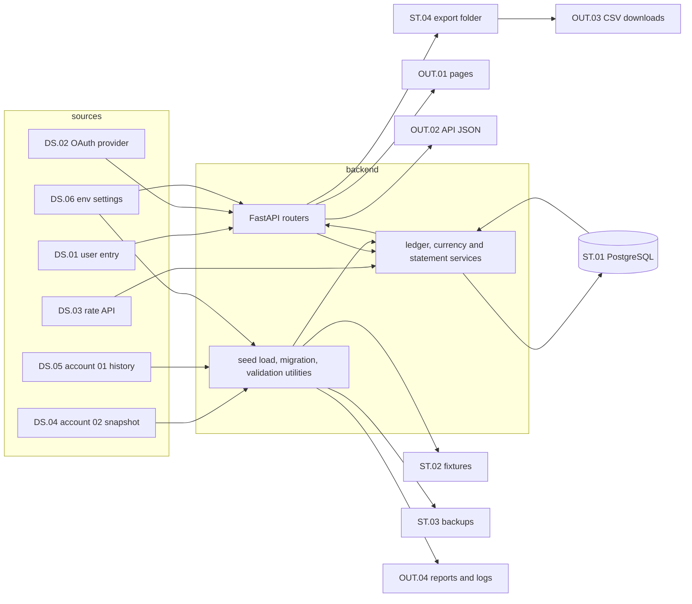

# RedBooks 0.2.0 - Data Flows

This document names every data source, store and output of RedBooks `0.2.0`, and the flow that moves data between them for each of the **workflows**. It is design topic 04.02 of the **release milestones**. The **data model** defines the tables inside the database store, and the **front end pages** call the flows that serve each page.

## Summary

01. **one database is the single store of record.** The PostgreSQL database holds users and their settings, currencies, rates, accounts, categories, ledger entries, transaction records, the ledger change log and the statement snapshots. Balances, totals and month to date statements are computed from it on request.
02. **closed months are stored as snapshot versions.** A snapshot holds both statements for one user, month and reporting currency. A re-run adds a version and closes the one before, as a slowly changing dimension of type 2, and every report reads the current version. The snapshot job generates each closed month once, on the 1st in the user's timezone or on the next start after it.
03. **every ledger write records a change and marks snapshots stale.** The ledger change log holds the before and after of each write, so a stale snapshot can show its changes.
04. **data enters from six sources.** The user's entries in the web app, the OAuth provider's identity claims, the rate API's currency list and rates, the HomeBudget account `02` database through its dated snapshot in `data/`, the account `01` database, and the `.env` settings file.
05. **every ledger write runs through the ledger service in one database transaction.** Expenses, income, transfers, opening balances, the seed load and the migration all call it, so every path into the ledger enforces the same invariants, per LL.16 of the **lessons learned**.
06. **a rate is fetched once and stored.** The rate client fetches a pair and date the store lacks, stores it with its source, and every later request reads the store. A user rate sits next to the fetched one and wins in every conversion.
07. **outputs are pages, JSON, CSV files and reports.** The web app renders API responses. CSV exports are written to a local export folder on the host and downloaded to the device. The seed load, the migration and the validation utilities write reports and logs to uncommitted locations.
08. **personal data stays out of git.** The snapshot, the seed, the database, backups, exports, logs and the migration reports live in gitignored locations. Committed fixtures carry hypothetical names only, per LL.08 of the **lessons learned**.

## Contents

- [Summary](#summary)
- [References](#references)
- [Overview](#overview)
- [Data sources](#data-sources)
- [Data stores](#data-stores)
- [Outputs](#outputs)
- [Flows](#flows)
- [Flow rules](#flow-rules)
- [Personal data locations](#personal-data-locations)
- [Traceability](#traceability)

## References

- **release notes**: [020-release.md](../020-release.md)
- **release milestones**: [020-release-milestones.md](../020-release-milestones.md)
- **workflows**: [workflows.md](workflows.md)
- **front end pages**: [front-end-pages.md](front-end-pages.md)
- **data model**: [data-model.md](data-model.md)
- **accounting rules**: [accounting-rules.md](accounting-rules.md)
- **homebudget accounts**: [homebudget-accounts.md](homebudget-accounts.md)
- **lessons learned**: [easymcf-lessons-learned.md](easymcf-lessons-learned.md)
- **test strategy**: [test-strategy.md](test-strategy.md)
- **homebudget wrapper**: [https://github.com/yayfalafels/homebudget](https://github.com/yayfalafels/homebudget)
- **homebudget data review**: [homebudget-data-review.md](homebudget-data-review.md)
- **snapshot**: the newest dated copy of the account `02` HomeBudget database in the gitignored `data/homebudget-02/` folder, written by `scripts/snapshot_homebudget_02.py` from the file named by `HB_DB_ACCOUNT_02_PATH` in `.env`

## Overview

The diagram shows the sources on the left, the stores in the middle and the outputs on the right. Every arrow into the database passes through the backend.

## Data sources

| id    | source                   | form                                | read by                   |
| ----- | ------------------------ | ----------------------------------- | ------------------------- |
| DS.01 | user entry               | form fields in the web app          | API routers               |
| DS.02 | OAuth provider           | authorization code and ID token     | sign-in callback          |
| DS.03 | rate API                 | JSON currency list and daily rates  | rate client               |
| DS.04 | account `02` snapshot    | SQLite copy in `data/homebudget-02` | seed load                 |
| DS.05 | account `01` database    | frozen SQLite file from `.env`      | migration                 |
| DS.06 | env settings             | `.env` file                         | one settings object       |

01. **DS.01** every value arrives as a string and is converted at the API boundary. Amounts and rates are decimal strings, per LL.28 of the **lessons learned**.
02. **DS.02** RedBooks reads the provider's subject id, email and display name. The provider's tokens are used once at the callback and are not stored.
03. **DS.03** the rate API is the one the **homebudget wrapper** uses. Its currency list feeds the currency catalog, and its daily rates feed the exchange rates store. Design task 04.19 probes its behavior and saves its responses as fixtures.
04. **DS.04** the **snapshot** is a HomeBudget SQLite database. The seed reads its Account, AccountTrans, Expense, Income, Transfer, Category, SubCategory, Payee and DeviceInfo tables, per the layout in the **homebudget data review**. The users JSON beside it in `data/` holds the seed users' ids and usernames.
05. **DS.05** the account `01` HomeBudget database, frozen at 2026-05-23, read-only with the same layout as DS.04, per the **homebudget data review**.
06. **DS.06** the app, the scripts and the tests read `.env` through one settings object, per LL.01 of the **lessons learned**. Secrets such as the OAuth client secret and the database password come only from it.

## Data stores

| id    | store                     | location                         | holds                                   |
| ----- | ------------------------- | -------------------------------- | --------------------------------------- |
| ST.01 | PostgreSQL database       | Docker volume                    | every record of every user              |
| ST.02 | expected-value fixtures   | uncommitted fixtures folder      | balances, totals, fx transfer amounts   |
| ST.03 | database backups          | uncommitted backups folder       | a dump before every opted-in write      |
| ST.04 | CSV export folder         | uncommitted exports folder       | every CSV the app has produced          |
| ST.05 | committed test fixtures   | `tests/fixtures/`                | canned API and rate API responses       |
| ST.06 | logs                      | uncommitted logs folder          | one structured record per run or case   |
| ST.07 | browser session           | HTTP-only cookie                 | the session id only                     |

01. **ST.01** the database groups its tables in five areas. The **data model** defines each table, and every user-owned table carries an owner reference.
    01. **identity**: users with their timezone setting, OAuth identities and sessions.
    02. **currency**: the currency catalog, each user's currencies, the reporting currency setting, and the exchange rates with their source, fetched or user.
    03. **books**: accounts with their type and currency, reconciled balance points, categories and subcategories.
    04. **ledger**: ledger entries, signed by their contribution to net worth, per AR.01 of the **accounting rules**, the expense, income and transfer records that own them, and the ledger change log.
    05. **statements**: snapshot versions keyed by user, month and reporting currency, with their validity period, current flag, run kind and stale flags, the snapshot lines of both statements, the rates each snapshot used, and the snapshot job runs.
    06. **schema**: the migration head, once versioned forward migrations start before the account `01` migration.
02. **ST.02** the seed load writes the fixtures from the **snapshot** files directly, never from the database, so a reference check compares two independent paths.
03. **ST.04** the export folder is the local file storage of the **release notes**. Release `0.3.0` moves it to S3 behind the same export service.
04. **ST.05** canned responses are captured from real responses and reduced to hypothetical names before they are committed, per 02.FE.03 of the **test strategy**.
05. **ST.07** the browser keeps no copy of the books. Each page reads the API when it opens and after every write, and form input in progress lives only in the page's state.

## Outputs

| id     | output                   | produced by                       | consumer                     |
| ------ | ------------------------ | --------------------------------- | ---------------------------- |
| OUT.01 | rendered pages           | React app from API responses      | the user on a phone          |
| OUT.02 | API JSON                 | FastAPI routers                   | the web app and automations  |
| OUT.03 | CSV downloads            | export service through ST.04      | the user's spreadsheet       |
| OUT.04 | reports and logs         | seed load, migration, utilities   | the developer                |

01. **OUT.02** the API is the integration surface for automation workflows, per the **release notes**. Every response is scoped to the signed-in user, and amounts are decimal strings.
02. **OUT.03** each CSV holds the same rows and values as the view or list it came from. The income statement CSV shows expenses as positive amounts, as on screen, per AR.18 of the **accounting rules**. The file name carries the statement, the period and the export time.
03. **OUT.04** the migration report counts the records added and skipped for each kind and lists every row a migration rule handled. The validation utilities report each case as pass, fail or error.

## Flows

Each flow names its trigger, its path from source to store or output, and the workflow it serves. A flow that writes the ledger runs in one database transaction.

| id    | flow                             | from          | to             | workflows             |
| ----- | -------------------------------- | ------------- | -------------- | --------------------- |
| DF.01 | sign in and session              | DS.02         | ST.01, ST.07   | WF.01                 |
| DF.02 | currency catalog load            | DS.03         | ST.01          | WF.02, seed load      |
| DF.03 | user currencies and reporting    | DS.01         | ST.01          | WF.02                 |
| DF.04 | rate fetch and store             | DS.03         | ST.01          | WF.03, WF.06 to WF.08 |
| DF.05 | user rate entry                  | DS.01         | ST.01          | WF.03                 |
| DF.06 | account write                    | DS.01         | ST.01          | WF.04                 |
| DF.07 | category write                   | DS.01         | ST.01          | WF.05                 |
| DF.08 | expense and income write         | DS.01         | ST.01          | WF.06, WF.07, WF.09   |
| DF.09 | transfer write                   | DS.01         | ST.01          | WF.08, WF.09          |
| DF.10 | ledger and transaction read      | ST.01         | OUT.01, OUT.02 | WF.10 to WF.12        |
| DF.11 | statement read                   | ST.01         | OUT.01, OUT.02 | WF.13, WF.14          |
| DF.12 | CSV export                       | ST.01         | ST.04, OUT.03  | WF.12 to WF.14        |
| DF.13 | account `02` seed load           | DS.04         | ST.01, ST.02   | developer tool        |
| DF.14 | account `01` migration           | DS.05         | ST.03, ST.01   | developer tool        |
| DF.15 | reference checks                 | ST.01, ST.02  | OUT.04         | developer tool        |
| DF.16 | snapshot generation              | ST.01         | ST.01          | WF.15                 |
| DF.17 | change log and stale marking     | ST.01         | ST.01          | WF.16                 |
| DF.18 | snapshot re-run and regenerate   | ST.01         | ST.01          | WF.16, WF.18          |
| DF.19 | statement history read           | ST.01         | OUT.01, OUT.02 | WF.17                 |
| DF.20 | user settings write              | DS.01         | ST.01          | WF.19                 |

**DF.01 sign in and session.** The sign-in route redirects to the provider with PKCE and a state value. The callback exchanges the code, validates the ID token, finds or creates the user and the identity, writes a session row and sets the session cookie. Every later request reads the session cookie, loads the session and its user, and scopes every query to that user. Sign-out deletes the session row.

**DF.02 currency catalog load.** The currency service reads the rate API's currency list and upserts the catalog with each code and name, and the number of decimal places from the ISO 4217 table. It runs at seed load and on demand. A failure leaves the catalog unchanged.

**DF.03 user currencies and reporting.** Adding a currency writes a user currency row that references one catalog currency. Removing one deletes the row unless an account holds it or it is the reporting currency, in which case the response names what uses it. Setting the reporting currency writes the user's setting and starts DF.18 for the years the user checked, per WF.18.

**DF.04 rate fetch and store.** A conversion or a form asks the currency service for the rate of a pair on a date.

01. a user rate for the pair and date is returned first.
02. otherwise a stored fetched rate for the pair and date is returned.
03. otherwise the rate client fetches it with explicit timeouts, stores it with its source and fetch time, and returns it. Rates keep the full precision the API returns.
04. a failed fetch returns an error that names its cause, and stores nothing.

**DF.05 user rate entry.** The user's rate for a pair and date is stored next to the fetched rate with the source user. Deleting it restores the fetched rate. Recording or removing a user rate runs DF.17 for its date. A rate typed on one transaction is stored on that transaction only, per DF.08 and DF.09.

**DF.06 account write.** Creating an account writes the account row and its opening balance as its first reconciled balance point, then posts the opening balance through the ledger service against opening balance equity, per AR.10 of the **accounting rules**. A change to an opening balance runs DF.17 for its date. Retiring an account sets its retire flag, per LL.12 of the **lessons learned**.

**DF.07 category write.** Category and subcategory writes touch only the category tables. A subcategory references one category of the same kind. Moving a subcategory to another category runs DF.17 for every month with its entries. Retiring follows DF.06.

**DF.08 expense and income write.** The router validates the request and passes it to the ledger service, which in one database transaction:

01. checks that the account, the subcategory and the currency belong to the user, and that a foreign currency account receives only its own currency.
02. resolves the rate through DF.04 when the entered currency differs from the account's currency, unless the request carries an override.
03. computes the ledger amount as the entered amount times the rate, rounded to the account currency's decimal places, and sets its sign from the record kind, per AR.05 and AR.06.
04. writes the record with its entered currency, entered amount and rate, and its ledger entry.
05. runs DF.17 for the record's date, and for its old date as well when an edit moves it.

An edit replaces the record's fields and its ledger entry in one database transaction. A delete removes both.

**DF.09 transfer write.** The ledger service writes the transfer record and its two ledger entries in one database transaction: a negative entry on the from account and a positive entry on the to account, each in its account's currency. For a transfer between currencies it stores the rate and both amounts, taking the side the user typed as given and computing the other side from the rate, per AR.12 item 04. An edit or a delete changes both entries together. Every write runs DF.17 in the same database transaction.

**DF.10 ledger and transaction read.** The account list reads each account's balance on today's date. The ledger reads one account's entries for a month and the balance at the end of the month before, and computes the running balance. Every balance is the nearest reconciled balance point before the date plus the signed entries between, per AR.11. The transaction list reads records by account, category, subcategory and date range, ordered by date and then by id, per LL.15 of the **lessons learned**.

**DF.11 statement read.** The statement service answers a view from one of two sources.

01. a closed month reads the current snapshot version for the user, month and reporting currency. A year view reads the current version of each closed month in one currency, and the month to date run for the current month.
02. the current month is a month to date run, built on request and never stored.
03. a stale snapshot is also built live, and the response carries each line's snapshot amount, current amount and difference.
04. the drill down for a line returns the records that sum to its current amount.

**Statement build.** DF.11, DF.16 and DF.18 build statements with one builder from the ledger, the category model, a reporting currency and the stored rates.

01. the income statement sums the signed expense and income entries by subcategory for the month, converts them to the reporting currency, and rolls subcategories up into categories.
02. the balance sheet computes each account's balance at the month end, converts it with the month-end rate, groups accounts by asset class and sums net worth.
03. the forex gain or loss for a month comes from each foreign currency balance and the rates at the start and end of the month, by the rule the multi currency and forex topic, 04.08, sets. It shows as its own line, is stored in a snapshot like any other line, and is never posted to the ledger.
04. every rate the build needs and the store lacks is fetched through DF.04 before the build runs.
05. month boundaries follow the user's timezone setting.

**DF.12 CSV export.** The export service builds the same response as the view or list, flips expense signs for the income statement as on screen, carries the snapshot version and run time for a closed month or the month to date marker for the current month, writes the CSV to the export folder, and returns it as a file download. The browser saves it on the device.

**DF.13 account `02` seed load.** The seed load rebuilds the schema and reads the **snapshot**.

01. it creates the seed users from the users file, then loads the catalog through DF.02 and gives the seed user SGD and USD with SGD as the reporting currency.
02. it creates the accounts from the snapshot's Account table, each with its reconciled balance point, through DF.06.
03. it creates the categories and subcategories from the snapshot's Category and SubCategory tables.
04. it posts every expense, income and transfer dated on or before the snapshot date through the ledger service, with each account-side amount from AccountTrans. A transfer between currencies takes both amounts from AccountTrans and derives the rate. The rules of the **homebudget data review** decide every skipped or changed row.
05. it fetches and stores the USD to SGD rate for every date the seed needs, through DF.04.
06. the fixture builder writes the expected-value fixtures to ST.02 from the snapshot with plain SQL, without RedBooks code, per the expected-value oracles of the **homebudget data review**.
07. it generates a snapshot of every month it loaded through DF.16, with the run kind migration.

**DF.14 account `01` migration.** The migration reads DS.05, maps each legacy category onto its income statement line through the legacy workbook mapping, and builds the match key for each record from its HomeBudget primary key. A dry run writes only the report. An opted-in run first writes a backup to ST.03, then upserts each account, category, transaction and transfer through the ledger service, committing progress in batches and recording its status. It then generates a snapshot of every month it loaded through DF.16, with the run kind migration, which closes any earlier version of those months. Identical transactions on the same day keep their own primary keys. A second run adds zero records.

**DF.15 reference checks.** The validation utilities read balances, the migration snapshots' statement totals and transfer amounts from the database through the services, read the expected values from ST.02, and write one record per check to OUT.04.

**DF.16 snapshot generation.** The snapshot job runs at backend start and then every hour. For each user it finds every closed month, in the user's timezone, from the first entry to last month, with no snapshot in any reporting currency, and builds each one oldest first in the current reporting currency. Each snapshot is written in one database transaction: its lines, its rates, and a version row that is current, valid from its run time, with run kind scheduled or migration. Each job run records its status and reaches succeeded or failed, with the original exception on failure, per LL.42 of the **lessons learned**.

**DF.17 change log and stale marking.** Inside the database transaction of each ledger, rate, opening balance or category write, the ledger service:

01. writes a change log row with the record kind and id, the change kind, the before and after values, the dates it touches and the change time.
02. marks the current income statement snapshot of each month the write touches stale.
03. marks the current balance sheet snapshot of each month the write touches, and of every later month, stale.

The snapshot changes page reads the change log rows for a month that are newer than the snapshot's run time. For the balance sheet, it reads every row dated on or before the month end.

> **implementation decision**: stale marking writes a flag at change time, so a page shows a stale marker without rebuilding the month. The change log holds the before and after of each write, which is the only way to show a deleted or edited transaction after the fact. It also records history that statement reconciliation can use in `0.4.0`.

**DF.18 snapshot re-run and regenerate.** A re-run builds the month again in the snapshot's reporting currency. A regenerate after a reporting currency change builds every closed month of the checked years in the new currency. In both, each month is written in one database transaction: the current version for its user, month and currency gets its valid to time and loses its current flag, and the new version becomes current with run kind re-run or currency change. The other currencies' versions of the month stay as they are. A regenerate runs as a job with a status and progress the page polls.

**DF.19 statement history read.** The history reads every snapshot version of the user grouped by year, then by reporting currency where a year holds more than one, then by month. Each month carries its current version's run time, run kind, version count and stale flags. A version list reads every version of one month and currency, and an older version opens read-only.

**DF.20 user settings write.** The settings write stores the user's timezone, an IANA name, checked against the timezone database. The user record takes Asia/Singapore at first sign-in.

## Flow rules

01. **one path into the ledger.** Every ledger write, from a form, the seed load or the migration, calls the ledger service, so the balance, sign and currency invariants hold on every path, per LL.16 and LL.43 of the **lessons learned**.
02. **one authority per state.** The record that owns a ledger entry is its only authority. Balances, totals and month to date statements are derived on read. A snapshot version is the authority for what a statement said when it ran, and the current version flag is the authority for which one a report shows, enforced by a partial unique index, per LL.14. Statement values are never written back to the ledger, per LL.13.
03. **user scope on every read and write.** Every query filters by the signed-in user. A request for another user's record answers not found.
04. **exact decimals end to end.** Amounts and rates are NUMERIC in the database, Decimal in Python and decimal strings in JSON and CSV. Rounding happens once, when a converted amount is stored or a statement line is presented.
05. **ordered results.** Every list whose order a page or test relies on is ordered in its query.
06. **the second opt-in guards writes to the working database.** The seed rebuild runs on the development database. The migration and every utility that writes to the user's working database refuse to run without the second opt-in, and back up first, per LL.03.
07. **writes refresh every view.** After a write, the web app reloads every view that shows the changed data, and keeps input the user is still typing, per LL.27.

## Personal data locations

| id    | data                                   | location                 | committed |
| ----- | -------------------------------------- | ------------------------ | --------- |
| PD.01 | HomeBudget databases and snapshots     | `data/` and `.env` paths | no        |
| PD.02 | database and its Docker volume         | Docker volume            | no        |
| PD.03 | backups, exports, logs, reports        | uncommitted folders      | no        |
| PD.04 | expected-value fixtures                | uncommitted fixtures     | no        |
| PD.05 | canned API and rate API fixtures       | `tests/fixtures/`        | yes       |
| PD.06 | OAuth client secret and DB password    | `.env`                   | no        |

PD.05 is committed only after its names are reduced to hypothetical names at real Singapore institutions. Rate API responses hold no personal data and are committed as captured. The repo layout topic, 04.12, fixes the folder names and their `.gitignore` entries.

## Traceability

01. **closure criterion 03 of the design milestone**: every data source, store and output is named in the three tables above, and every flow names the workflow that moves its data.
02. **multiple currencies**, RN.03: DF.02 to DF.05, DF.08, DF.09 and DF.11.
03. **financial statements and CSV export**, RN.04: DF.11 and DF.12.
04. **users and login**, RN.05: DF.01 and flow rule 03.
05. **HomeBudget history**, RN.07: DF.13 to DF.15.
06. **personal data**, closure criterion 09 of the design milestone: the personal data locations table.
