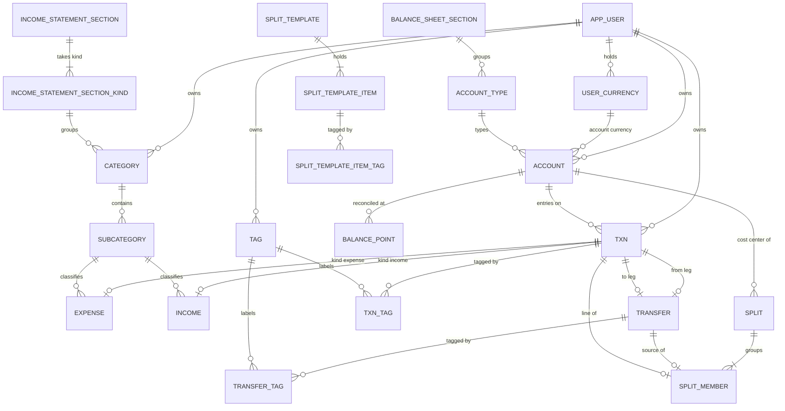
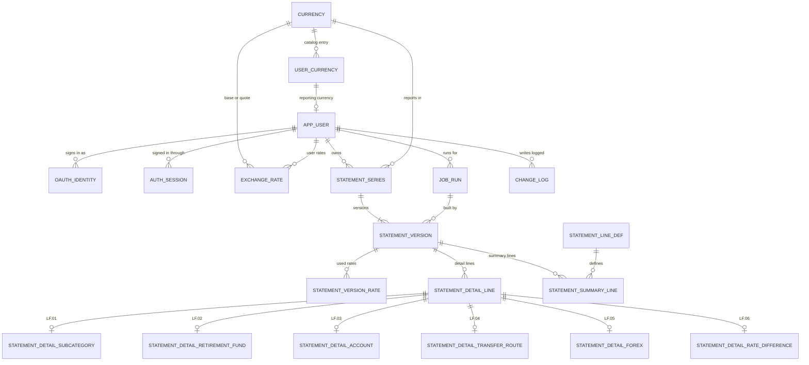

# RedBooks 0.2.0 - Data Model

This doc defines every entity of the RedBooks `0.2.0` PostgreSQL database: its columns, data types, keys, constraints, ownership and relations, and the API resource it backs. It is design topic 04.05 of the **release milestones**. The entities follow from the **workflows**, the **data flows**, the **accounting rules** and the **financial statements design**, and the same model is the contract for the schema build and for the API routes of topic 04.15.

## Contents

- [Summary](#summary)
- [References](#references)
- [Entity list](#entity-list)
- [Entity-relationship overview](#entity-relationship-overview)
- [Model decisions](#model-decisions)
- [Conventions](#conventions)
- [Identity](#identity)
- [Currency](#currency)
- [Books](#books)
- [Ledger](#ledger)
- [Splits](#splits)
- [Statements](#statements)
- [Operations](#operations)
- [Cross-table invariants](#cross-table-invariants)
- [Derived read models](#derived-read-models)
- [Traceability](#traceability)
- [Handoffs](#handoffs)

## Summary

01. **one general ledger of account entries.** Every movement on an account is one signed `txn` row, per AR.01 of the **accounting rules**. The income and expense side lives on the expense and income records, which name the subcategory, and the opening balance equity side is implicit in the opening entry.
02. **a record per kind over the entries.** An expense or income record is one `txn` row with its subtype, keyed by the row's id. A transfer is its own record that pairs two `txn` rows, a sent leg and a received leg. An opening balance is one `txn` row with no subtype. Notes, tags and the match key sit on the record.
03. **a transfer pairs two legs.** Each leg is a `txn` of kind `transfer` that belongs to exactly one transfer, and the two legs sit on two different accounts with opposite signs on one date, IV.03.
04. **a split is its own model over ordinary records.** A `split` header names its date, notes and hidden cost center, whose currency is the split's, and every date of a split falls in one calendar month. Its payment sources are transfers with the cost center, and its category lines are expense and income records on the cost center, each a full record joined to the split through `split_member`. Split templates hold saved rows in their own tables and post nothing.
05. **a statement series holds versions.** A `statement_series` is one user, month and reporting currency. Each run writes a `statement_version` in its series, unique by its valid from time, and current while its valid to time is empty. The version owns the detail lines, summary lines and rates of both statements.
06. **ownership is in every key.** Every user-owned table carries `owner_id`, apart from two leaf tables that take it from their one parent, and every other foreign key between user-owned tables includes it, so the database rejects a row that points at another user's row.
07. **derived values stay derived.** Balances, running balances, tag balances, year stale markers and the presentation view are computed on read. The opening entry is the one stored derived value: its date and amount follow from the current balance point, and the ledger service rewrites it in the same database transaction as any write that moves them, per IV.02. The stored statement lines are the one authority for what a statement said when it ran.

## References

- **release notes**: [020-release.md](../020-release.md)
- **release milestones**: [020-release-milestones.md](../020-release-milestones.md)
- **accounting rules**: [accounting-rules.md](accounting-rules.md)
- **financial statements design**: [financial-statements.md](financial-statements.md)
- **workflows**: [workflows.md](workflows.md)
- **data flows**: [data-flows.md](data-flows.md)
- **front end pages**: [front-end-pages.md](front-end-pages.md)
- **data migration**: [data-migration.md](data-migration.md)
- **homebudget data review**: [homebudget-data-review.md](homebudget-data-review.md)
- **test cases**: [test-cases.md](test-cases.md)
- **lessons learned**: [easymcf-lessons-learned.md](easymcf-lessons-learned.md)
- **easyMCF data model**: `easymcf/docs/design/data-model.md`, the layout reference for this doc
- **financial-statements data model**: `financial-statements/docs/releases/010/requirements/data-model.md`
- **postgresql skill**: `.claude/skills/postgresql/SKILL.md`

## Entity list

Each entity is one table. The API column names the resource of the **front end pages** API calls table that reads or writes it. A dash marks a table the API never exposes.

| id    | entity                             | area       | holds                              | api resource           |
| ----- | ---------------------------------- | ---------- | ---------------------------------- | ---------------------- |
| EN.01 | `app_user`                         | identity   | a person and their settings        | `/me`, `/settings`     |
| EN.02 | `oauth_identity`                   | identity   | a provider subject of a user       | -                      |
| EN.03 | `auth_session`                     | identity   | a signed-in browser session        | -                      |
| EN.04 | `currency`                         | currency   | the rate API currency catalog      | `/currencies/catalog`  |
| EN.05 | `user_currency`                    | currency   | a currency a user holds            | `/currencies`          |
| EN.06 | `exchange_rate`                    | currency   | a fetched or user rate             | `/rates`               |
| EN.07 | `balance_sheet_section`            | books      | the net worth sections             | `/account-types`       |
| EN.08 | `account_type`                     | books      | account type such as cash          | `/account-types`       |
| EN.09 | `account`                          | books      | an asset, liability or cost center | `/accounts`            |
| EN.10 | `balance_point`                    | books      | a reconciled balance on a date     | `/accounts/:id/...`    |
| EN.11 | `income_statement_section`         | books      | statement sections                 | `/categories`          |
| EN.12 | `category`                         | books      | an income or expense category      | `/categories`          |
| EN.13 | `subcategory`                      | books      | a detail line under a category     | `/categories`          |
| EN.14 | `tag`                              | books      | a label for providers and people   | `/tags`                |
| EN.15 | `txn`                              | ledger     | a signed entry on one account      | `/accounts/:id/ledger` |
| EN.16 | `transfer_tag`                     | ledger     | a tag on a transfer                | tags on each record    |
| EN.17 | `expense`                          | ledger     | an expense or refund               | `/expenses`            |
| EN.18 | `income`                           | ledger     | an income record                   | `/income`              |
| EN.19 | `transfer`                         | ledger     | a move between two accounts        | `/transfers`           |
| EN.20 | `txn_tag`                          | ledger     | a tag on a transaction             | tags on each record    |
| EN.21 | `split`                            | splits     | one event across accounts          | `/splits`              |
| EN.22 | `split_member`                     | splits     | a source or line of a split        | `/splits`              |
| EN.23 | `split_template`                   | splits     | a saved split form                 | `/split-templates`     |
| EN.24 | `split_template_item`              | splits     | a row of a template                | `/split-templates`     |
| EN.25 | `split_template_item_tag`          | splits     | a tag on a template row            | `/split-templates`     |
| EN.26 | `statement_line_def`               | statements | statement lines                    | `/statements`          |
| EN.27 | `statement_series`                 | statements | a user, month and currency         | `/statements/history`  |
| EN.28 | `statement_version`                | statements | one run of a series                | snapshots, AC.12       |
| EN.29 | `statement_version_rate`           | statements | a month-end rate a version used    | `/statements`          |
| EN.30 | `statement_detail_line`            | statements | a line read from the ledger        | `/statements`          |
| EN.31 | `statement_summary_line`           | statements | a total or derived line            | `/statements`          |
| EN.32 | `change_log`                       | operations | before and after of each write     | snapshots, AC.12       |
| EN.33 | `job_run`                          | operations | a background run and its status    | snapshots, AC.12       |
| EN.34 | `schema_meta`                      | operations | the schema version marker          | -                      |
| EN.35 | `income_statement_section_kind`    | books      | a kind of category a section takes | `/categories`          |
| EN.36 | `statement_detail_subcategory`     | statements | a subcategory line, LF.01          | `/statements`          |
| EN.37 | `statement_detail_retirement_fund` | statements | a retirement fund line, LF.02      | `/statements`          |
| EN.38 | `statement_detail_account`         | statements | an account line, LF.03             | `/statements`          |
| EN.39 | `statement_detail_transfer_route`  | statements | a transfer route line, LF.04       | `/statements`          |
| EN.40 | `statement_detail_forex`           | statements | a forex line, LF.05                | `/statements`          |
| EN.41 | `statement_detail_rate_difference` | statements | an XD line, LF.06                  | `/statements`          |

01. **EN.10** the balance points read under `/accounts/:id/balance-points`, per PG.04 of the **front end pages**.
02. **EN.13** subcategories write through `/categories/:id/subcategories` and read nested under their category. Topic 04.15 fixes the final path.
03. **EN.07, EN.08, EN.11, EN.26 and EN.35** are seeded vocabularies. The API serves them read-only so the forms and the presentation view need no hardcoded lists.

## Entity-relationship overview

The books, ledger and splits:



Identity, currency, statements and operations:



## Model decisions

01. **DM.01 a single ledger of account entries.** The user settled a single general ledger with separate expense, income and transfer models, per requirements audit item 01.04.03 of the **release milestones**. A `txn` row is one entry, the account side of a record. The category side is the subcategory on the expense or income record, with the same signed amount in the account's currency, so AR.02 balances by construction: the record's amount and its entry's amount are one value. Opening balance equity has no row. Its balance is the sum of the opening entries, per AR.10.
02. **DM.02 records over the entries.** The `expense` and `income` subtypes share the id of their one `txn` row, and a `transfer` pairs two `txn` rows of its own, its legs. Each account movement is then one row with its own date, account and amount, and no column is copied between a record and its rows. The fields of a record as a whole, its notes, tags and match key, sit on the record, and each record table is the table behind its own API resource. Tags and split membership reach an expense or income through its `txn` row and a transfer through its `transfer` row, so `txn_tag` and `transfer_tag`, and the two references of `split_member`, serve the two.
03. **DM.03 a transfer pairs two legs.** A transfer is a record of its own with a sent leg and a received leg, each a `txn` of kind `transfer`. A key and a unique index per leg give every transfer two legs of its own. The rules across the two rows, one transfer per leg, two accounts, opposite signs and one date, are IV.03. The ledger service holds them with a check query, since no row constraint reaches across rows without copying them.
04. **DM.04 the split model.** A split owns a header and its members. Each member is an ordinary record, so a payment source is a real transfer that the account ledger and the account statement both see, and a category line is a real expense or income record that the income statement and its drill down both see, per AR.07 and WF.09. The membership table holds the order of the rows and their kind. The cost center is the account of type `clearing`, one per user and currency, that every picker and the balance sheet leave out. It holds 0.00 at every month end, since no split crosses a month boundary.
05. **DM.05 statement series and versions.** The series is the natural key of a statement month: user, month and reporting currency. It exists once, carries the id the history and the version list read by, and is the row a run locks before it writes its version. A version is one run, a slowly changing dimension of type 2: valid from its run time, valid to the run time of the version after it, and current while valid to is empty. Its current flag is generated from valid to, and a partial unique index allows one current version per series.
06. **DM.06 statement lines are immutable facts.** Detail and summary lines are written once with their version, per the statement data model of the **financial statements design**. A detail line's key is stored once, on its base row, and the deferred trigger of `statement_detail_line` holds it to its subtype's ids. A summary line's key is held to its definition's code by a foreign key, or to its category by a check. A key can never drift from the item it names. Each line of a dynamic item also stores the parent it sat under when the version ran, a subcategory's category, a category's section and an account's type, so an older version lays out as it was built, per PV.07. A stale marker lives on the version as the time it went stale.
07. **DM.07 ownership through composite keys.** Every user-owned table that another table references has a unique key on `owner_id, id`, and every reference to it carries the owner. A cross-user reference fails at the database, and every query filters by `owner_id`, or by the owned parent of a leaf table without one, per flow rule 03 of the **data flows** and convention 03.
08. **DM.08 retire over delete.** Accounts, categories, subcategories, tags and split templates carry `is_active`. A row that a transaction, a balance point or a statement line references is retired, and the references from history use `ON DELETE NO ACTION`. It rejects a direct delete like `RESTRICT`, but is checked at the end of the statement, so a user delete that cascades through both the history and the rows it names succeeds in any cascade order.
09. **DM.09 one match key column.** Each record the seed or the migration loads carries its source key in `match_key`, unique per owner, per the upsert match keys of the **homebudget data review**. A record entered in the app has none.

> **implementation decision**: vocabularies that carry attributes, such as an account type's section or a line's label and parent, are seeded tables. State values with no attributes, such as a run kind or a job status, are `text` columns with a `CHECK` list. Both follow the seeded vocabulary rule of the **postgresql skill**.

## Conventions

These conventions apply to every entity below. The entity tables list only the columns particular to each entity.

01. **names.** Tables and columns are `snake_case` and singular. The user table is `app_user`, since `user` is reserved in PostgreSQL.
02. **keys.** Every `id` is `bigint GENERATED ALWAYS AS IDENTITY PRIMARY KEY` unless the entity states another key. A seeded vocabulary's `id` is a `bigint PRIMARY KEY` whose value the seed fixes in its listed order, so a rebuild keeps every id. A vocabulary or catalog row carries its readable name in a unique `code` column, and no other table stores the code. No constraint names an id or a code. A rule that depends on a vocabulary row is data: a seeded table of the allowed pairs, such as `income_statement_section_kind`, or a boolean attribute of the row, copied onto the referencing row and held equal by a composite foreign key, such as `is_cost_center`. Every reference column ends in `_id`, per convention 10.
03. **ownership.** Every user-owned table has `owner_id bigint NOT NULL REFERENCES app_user (id) ON DELETE CASCADE` and `UNIQUE (owner_id, id)`. A rule of "FK `account`, owned" means a composite foreign key on `owner_id` and the column, referencing the unique key of that table. A table with one owned reference that no other table references, `balance_point` and `statement_version_rate`, takes its owner through that reference and has no `owner_id`. In every other child table, `owner_id` is the column all its owned keys share, so the rows it references belong to one user, and its own key to `app_user` cascades a user delete past the history keys of DM.08, which check only at the end of the statement. `oauth_identity` and `auth_session` name the column `user_id`, since they hold the user's sign-in rather than books the user owns.
04. **money.** Amounts are `numeric(19, 4)` and signed by their contribution to net worth, per AR.01. Each stored amount is rounded half up to its currency's decimal places, per AR.12 item 01. Rates are `numeric(20, 10)` and always positive. A currency is referenced by its id, and its `char(3)` ISO 4217 code lives only in `currency.code`.
05. **dates and times.** A calendar date, such as an entry date, is `date` in the user's timezone. A moment, such as a run time, is `timestamptz` stored in UTC.
06. **audit times.** Every mutable table also has `created_at` and `updated_at`, both `timestamptz NOT NULL DEFAULT now()`. An append-only table has `created_at` only, as each entity states.
07. **retire flag.** `is_active boolean NOT NULL DEFAULT true`, per DM.08.
08. **match key.** `match_key text NULL`, with `UNIQUE (owner_id, match_key)` where it is not null. Its value is `hb02:<table>:<device id>:<device key>` for an account `02` row, MK.01, or `hb01:<table>:<primary key>` for an account `01` row, MK.02.
09. **API types.** `bigint` travels as a JSON integer, `numeric` as a decimal string, `date` as `YYYY-MM-DD`, `timestamptz` as ISO 8601 in UTC, and a `text` vocabulary value as its string. `owner_id` never travels: the API takes it from the session. Generated columns and derived values are read-only. A currency, account type or statement section travels as its code, and the service resolves the code to its id, so paths and parameters such as `DELETE /currencies/:code` and `?currency=` stay readable.
10. **reference names.** Every reference column is named for the table it references with `_id`, such as `account_type_id` or `currency_id`, or for its role with `_id`, such as `base_currency_id` or `parent_id`.

## Identity

### `app_user`

A person who signs in. Every other user-owned row belongs to one user. The seed creates two users with distinct data, per database criterion 03 of the OAuth login milestone.

| id | column                | type        | null | rule                                   |
| -- | --------------------- | ----------- | ---- | -------------------------------------- |
| 01 | id                    | bigint      | no   | PK                                     |
| 02 | email                 | text        | no   | unique, stored lowercase               |
| 03 | display_name          | varchar(80) | no   | from the provider at first sign-in     |
| 04 | timezone              | text        | no   | default `Asia/Singapore`, see note 01  |
| 05 | reporting_currency_id | bigint      | yes  | FK `user_currency`, owned, see note 02 |

01. **timezone** holds an IANA name. `CHECK (is_iana_timezone(timezone))` calls a SQL function that looks the name up in `pg_timezone_names`, so the database rejects any other name, per WF.19 and DF.20.
02. **reporting_currency_id** is null until the user holds a currency, per WF.02. The composite key `id, reporting_currency_id` references `user_currency (owner_id, currency_id)` with `ON DELETE RESTRICT`, so a reporting currency stays in the user's list, per WF.02.03.
03. **API**: `GET /me` returns the id, email and display name. `GET` and `PATCH /settings` read and write the timezone, and `PUT /settings/reporting-currency` starts WF.18.

### `oauth_identity`

A provider subject linked to a user, found or created at the callback, per DF.01.

| id | column          | type         | null | rule                                |
| -- | --------------- | ------------ | ---- | ----------------------------------- |
| 01 | id              | bigint       | no   | PK                                  |
| 02 | user_id         | bigint       | no   | FK `app_user`, cascades on delete   |
| 03 | provider        | varchar(40)  | no   | the provider's issuer name          |
| 04 | subject         | varchar(255) | no   | unique with provider                |
| 05 | email           | text         | yes  | the email claim at the last sign-in |
| 06 | last_sign_in_at | timestamptz  | no   | set at each callback                |

01. the provider's tokens are used once at the callback and never stored, per DS.02 of the **data flows**.

### `auth_session`

A signed-in browser session. A row per sign-in, deleted at sign-out and purged after expiry. The browser cookie holds the token, and the row holds its digest.

| id | column       | type        | null | rule                                     |
| -- | ------------ | ----------- | ---- | ---------------------------------------- |
| 01 | id           | bigint      | no   | PK                                       |
| 02 | user_id      | bigint      | no   | FK `app_user`, cascades on delete        |
| 03 | token_hash   | bytea       | no   | unique, SHA-256 of the session token     |
| 04 | expires_at   | timestamptz | no   | the session is valid while now is before |
| 05 | last_seen_at | timestamptz | no   | refreshed on each request                |

01. append-only apart from `last_seen_at`. It has `created_at` and no `updated_at`.

## Currency

### `currency`

The catalog of every currency the rate API supports, shared by every user, per DF.02.

| id | column         | type        | null | rule                                     |
| -- | -------------- | ----------- | ---- | ---------------------------------------- |
| 01 | id             | bigint      | no   | PK                                       |
| 02 | code           | char(3)     | no   | unique, ISO 4217 code                    |
| 03 | name           | varchar(80) | no   | from the rate API currency list          |
| 04 | decimal_places | smallint    | no   | `CHECK (decimal_places BETWEEN 0 AND 4)` |
| 05 | is_active      | boolean     | no   | false once the rate API drops it         |

01. **decimal_places** comes from the ISO 4217 table, and sets the rounding of every amount in the currency.
02. **API**: `GET /currencies/catalog` lists the active catalog for the add currency search.

### `user_currency`

A currency a user holds, following the HomeBudget currency record, per database criterion 02 of the currency model milestone.

| id | column      | type        | null | rule                            |
| -- | ----------- | ----------- | ---- | ------------------------------- |
| 01 | owner_id    | bigint      | no   | PK with currency_id             |
| 02 | currency_id | bigint      | no   | FK `currency`                   |
| 03 | name        | varchar(80) | no   | defaults to the catalog name    |
| 04 | locale      | varchar(20) | yes  | display locale, such as `en_SG` |

01. the primary key `owner_id, currency_id` lets a user hold a currency once, and is the target of every owned currency reference.
02. an account or the reporting currency setting referencing the row blocks its removal through `ON DELETE RESTRICT`, and the API names what still uses it, per WF.02.03.
03. **API**: `GET` and `POST /currencies`, `DELETE /currencies/:code`.

### `exchange_rate`

A rate for an ordered currency pair on a date. A fetched rate is shared by every user. A user rate belongs to one user and takes the place of the fetched rate in every conversion for that user, per WF.03 and DF.04.

| id | column            | type           | null | rule                                     |
| -- | ----------------- | -------------- | ---- | ---------------------------------------- |
| 01 | id                | bigint         | no   | PK                                       |
| 02 | owner_id          | bigint         | yes  | FK `app_user`, set only for a user rate  |
| 03 | base_currency_id  | bigint         | no   | FK `currency`                            |
| 04 | quote_currency_id | bigint         | no   | FK `currency`, differs from base         |
| 05 | rate_date         | date           | no   | the date the rate serves                 |
| 06 | rate              | numeric(20,10) | no   | `CHECK (rate > 0)`, quote units per base |
| 07 | source            | text           | no   | one of `fetched`, `user`                 |
| 08 | published_date    | date           | yes  | see note 02                              |
| 09 | fetched_at        | timestamptz    | yes  | set for a fetched rate                   |

01. **source and owner agree**: `CHECK ((source = 'fetched') = (owner_id IS NULL))`. A fetched rate is unique on `base_currency_id, quote_currency_id, rate_date` where `source = 'fetched'`, and a user rate on `owner_id, base_currency_id, quote_currency_id, rate_date` where `source = 'user'`. Both are partial unique indexes, per database criterion 04 of the currency model milestone.
02. **published_date** is the date of the published rate a fetched row took. It equals `rate_date` on a business day, and is the last published date before it on a weekend or holiday, per WF.03.05.
    01. **provisional rate.** A fetched row whose `published_date` is before its `rate_date`, and whose `fetched_at` is before the end of the `rate_date` in UTC, may have been fetched before the source published that date's rate. The rate client refetches it on the next request and updates the row in place. A statement build refetches every provisional rate it needs before it runs, and CK.01 fails while one stays provisional, so the snapshot job retries the month on its next hourly run. The 04.19 probe confirms the publication time this rule assumes.
03. a rate typed on one transaction stays on that record's `rate` column and never writes here, per DF.05.
04. **API**: `GET /rates` lists the stored rates for the user, its own and the fetched ones. `POST /rates` and `DELETE /rates/:id` write user rates only. `GET /rates/lookup?from=&to=&date=` resolves a rate through DF.04.

## Books

### `balance_sheet_section`

The seeded net worth sections of the balance sheet, NW.02 to NW.06 of the **financial statements design**.

| id | column     | type        | null | rule                                        |
| -- | ---------- | ----------- | ---- | ------------------------------------------- |
| 01 | id         | bigint      | no   | PK, fixed by the seed                       |
| 02 | code       | text        | no   | unique                                      |
| 03 | name       | varchar(40) | no   | the section's name                          |
| 04 | parent_id  | bigint      | yes  | FK self, `liquid` for the three liquid ones |
| 05 | sort_order | smallint    | no   | layout order                                |

01. the seeded rows are `illiquid_retirement`, `liquid`, `cash_bank`, `liquid_investments` and `credit`, in that order. `liquid` is the parent of the last three and holds no account type.

### `account_type`

The eight seeded account types, TY.01 to TY.08 of the **financial statements design**. The type is the balance sheet subsection, and each type belongs to one section at any balance.

| id | column         | type        | null | rule                                       |
| -- | -------------- | ----------- | ---- | ------------------------------------------ |
| 01 | id             | bigint      | no   | PK, fixed by the seed                      |
| 02 | code           | text        | no   | unique                                     |
| 03 | name           | varchar(40) | no   | the type's name                            |
| 04 | section_id     | bigint      | no   | FK `balance_sheet_section`, a leaf section |
| 05 | is_subsection  | boolean     | no   | false for investment and retirement        |
| 06 | sort_order     | smallint    | no   | order within its section                   |
| 07 | has_line       | boolean     | no   | false for `clearing`, see note 03          |
| 08 | is_cost_center | boolean     | no   | true for `clearing` only, see note 05      |

01. the seeded codes are `wallet_cash`, `bank_account` and `clearing` in `cash_bank`, `credit_card`, `other_credit` and `margin_credit` in `credit`, `investment` in `liquid_investments`, and `retirement` in `illiquid_retirement`.
02. **is_subsection** marks the types that show a subsection total, LK.07. The investment and retirement types are their own section with no subsection.
03. **has_line** is false for `clearing` only. The cost center holds 0.00 at every month end, so the balance sheet shows no account line or subsection for it, and CK.06 fails a build where it does not, per the **financial statements design**.
04. **API**: `GET /account-types` returns the types with their sections, for the account form and the account list groups.
05. **is_cost_center** marks the type of the hidden cost center, per AR.07 item 06. A partial unique index on `is_cost_center` where it is true allows one such type. `UNIQUE (id, is_cost_center)` is the target of the account reference, per `account` note 03.

### `account`

An asset or liability the user tracks, in or outside net worth, including the hidden cost center of each currency.

| id | column          | type        | null | rule                                     |
| -- | --------------- | ----------- | ---- | ---------------------------------------- |
| 01 | id              | bigint      | no   | PK                                       |
| 02 | owner_id        | bigint      | no   | FK `app_user`                            |
| 03 | name            | varchar(80) | no   | unique among the owner's active accounts |
| 04 | currency_id     | bigint      | no   | FK `user_currency`, owned                |
| 05 | in_net_worth    | boolean     | no   | default true                             |
| 06 | account_type_id | bigint      | yes  | FK `account_type`, see note 01           |
| 07 | is_cost_center  | boolean     | no   | follows the type, see note 03            |
| 08 | sort_order      | integer     | no   | the user's account order                 |
| 09 | is_active       | boolean     | no   | retire flag                              |
| 10 | match_key       | text        | yes  | MK.01 or MK.02                           |

01. **type and net worth agree**: `CHECK (in_net_worth = (account_type_id IS NOT NULL))`. An account in net worth has a type, and one outside net worth, such as a counterparty, has none, per WF.04.02, MC.03 and MC.04 of the **data migration**. CK.05 then holds by constraint.
02. **currency is fixed once posted.** An entry holds no currency of its own, so its currency is always its account's. A `BEFORE UPDATE` trigger on `account` rejects a change of `currency_id` while any `txn` row names the account, per WF.04.05 and database criterion 06 of the txn and accounts milestone. `UNIQUE (owner_id, id, is_cost_center)` is the target of the split's cost center key.
03. **the cost center is the `clearing` type.** `is_cost_center` is copied from the type and held equal by the composite foreign key `account_type_id, is_cost_center` to `account_type (id, is_cost_center)` with `ON UPDATE CASCADE`, and `CHECK (account_type_id IS NOT NULL OR NOT is_cost_center)` covers an account with no type. A partial unique index on `owner_id, currency_id` where `is_cost_center` allows one cost center per user and currency, per AR.07 item 06. The ledger service creates it on the first split or split template in a currency, per DF.21, and the account `01` cost centers of each currency map onto it, per task 12.03 of the **data migration**. Every picker, form and the account list leave out the `clearing` type, and the balance sheet shows no line for it, per `account_type` note 03.
04. **name uniqueness** is a partial unique index on `owner_id, name` where `is_active`, per PG.05.
05. the opening balance and opening date are derived from the account's opening entry, per [Derived read models](#derived-read-models), and are never columns here.
06. **API**: CRUD on `/accounts`, `POST /accounts/:id/retire` and `/restore`, and `GET /accounts?include=balance`. Creating an account takes its balance and balance date, its reconciled balance point, in the same request, and a later edit of either writes a new current point, per DF.06. Delete succeeds only for an account that no entry other than its opening entry, no split and no statement line references, and retire covers every other case.

### `balance_point`

A reconciled balance on any date, confirmed against an independent source. An account has exactly one current point at any time, and every balance of the account, before or after the point's date, derives from it and the signed entries, per AR.11. A new point replaces the current one, and the replaced point stays as history, a slowly changing dimension of type 2 like the statement versions.

| id | column     | type          | null | rule                                |
| -- | ---------- | ------------- | ---- | ----------------------------------- |
| 01 | id         | bigint        | no   | PK                                  |
| 02 | account_id | bigint        | no   | FK `account`, cascades, see note 06 |
| 03 | point_date | date          | no   | any date, see note 02               |
| 04 | balance    | numeric(19,4) | no   | signed, in the account currency     |
| 05 | source     | text          | no   | one of `user`, `seed`, `migration`  |
| 06 | valid_from | timestamptz   | no   | when the point became current       |
| 07 | valid_to   | timestamptz   | yes  | when a new point replaced it        |
| 08 | is_current | boolean       | no   | generated as `valid_to IS NULL`     |

01. **one current point per account**: a partial unique index on `account_id` where `valid_to IS NULL`, and `CHECK (valid_to IS NULL OR valid_to > valid_from)`. A new point sets the current one's `valid_to` to its own `valid_from` in the same database transaction. The ledger service keeps exactly one current point on every account, IV.01.
02. **any date.** `point_date` can sit before, among or after the account's entries, and a history row can carry any date too. The history records what the point was at each time, so it explains a past statement version built from an earlier point.
03. **upsert.** The seed and the migration match the current point by account and date, MK.03 of the **homebudget data review**. A reload with the same date and balance skips it, and any other value writes a new current point.
04. the account `01` migration replaces each paired account's current point with its last account `01` point, and the account `02` point becomes history, per MR.10 of the **data migration**.
05. **API**: `GET /accounts/:id/balance-points` returns the current point, then the history newest first by `valid_from`, read-only in `0.2.0`, per the implementation decision of WF.04. A new point is written through the account form.
06. **owner through the account.** The point has no `owner_id`, per convention 03: its owner is its account's, and every read reaches it through an account the user owns.

### `income_statement_section`

The five seeded sections, IS.01 to IS.05 of the **financial statements design**.

| id | column     | type        | null | rule                  |
| -- | ---------- | ----------- | ---- | --------------------- |
| 01 | id         | bigint      | no   | PK, fixed by the seed |
| 02 | code       | text        | no   | unique                |
| 03 | name       | varchar(40) | no   | the section's name    |
| 04 | sort_order | smallint    | no   | layout order          |

01. the seeded codes are `personal`, `investment`, `rental`, `cole` and `discretionary`, in that order.
02. the kinds of category a section takes are rows of `income_statement_section_kind`.

### `income_statement_section_kind`

A kind of category a section takes, per the category kind column of the income statement sections table of the **financial statements design**. Kind is a dimension of its own beside the section: two sections take both kinds.

| id | column     | type   | null | rule                                    |
| -- | ---------- | ------ | ---- | --------------------------------------- |
| 01 | section_id | bigint | no   | FK `income_statement_section`, PK, kind |
| 02 | kind       | text   | no   | one of `income`, `expense`              |

01. the primary key is `section_id, kind`, the target of the category reference, per `category` note 01.
02. the seeded pairs are `personal` and `investment` with `income` and `expense`, and `rental`, `cole` and `discretionary` with `expense` only.
03. a transfer and an opening balance post to no category, so neither kind appears here.

### `category`

The upper level of the two-level category model, with its required statement section.

| id | column     | type        | null | rule                                   |
| -- | ---------- | ----------- | ---- | -------------------------------------- |
| 01 | id         | bigint      | no   | PK                                     |
| 02 | owner_id   | bigint      | no   | FK `app_user`                          |
| 03 | name       | varchar(80) | no   | unique per owner and kind among active |
| 04 | kind       | text        | no   | one of `income`, `expense`             |
| 05 | section_id | bigint      | no   | FK `income_statement_section`, note 01 |
| 06 | sort_order | integer     | no   | order within its section               |
| 07 | is_active  | boolean     | no   | retire flag                            |
| 08 | match_key  | text        | yes  | MK.01 or MK.02                         |

01. **the section takes the kind**: the composite foreign key `section_id, kind` references `income_statement_section_kind (section_id, kind)`, so an income category sits only in a section that takes income.
02. `UNIQUE (owner_id, id, kind)` is the target of the subcategory reference, so a category's kind cannot change while it holds subcategories.
03. every user is seeded with the investment P and L categories IP.01 to IP.07 and the personal income categories PS.01 to PS.09, per the **financial statements design**.
04. **API**: CRUD on `/categories`, `POST /categories/:id/retire`, and month totals per category, per AC.06 of the **front end pages**. The list takes `?kind=`.

### `subcategory`

A detail line of the income statement. Every expense and income record names one, per WF.05.

| id | column      | type        | null | rule                                    |
| -- | ----------- | ----------- | ---- | --------------------------------------- |
| 01 | id          | bigint      | no   | PK                                      |
| 02 | owner_id    | bigint      | no   | FK `app_user`, in every owned key       |
| 03 | category_id | bigint      | no   | FK `category` with kind, owned          |
| 04 | kind        | text        | no   | equals its category's kind, see note 01 |
| 05 | name        | varchar(80) | no   | unique within its category among active |
| 06 | sort_order  | integer     | no   | order within its category               |
| 07 | is_active   | boolean     | no   | retire flag                             |
| 08 | match_key   | text        | yes  | MK.01 or MK.02                          |

01. **kind** is copied from the category and held equal by the composite foreign key `owner_id, category_id, kind` to `category (owner_id, id, kind)`. A move to another category of the same kind passes, and a move to the other kind fails, per WF.05.05.
02. `UNIQUE (owner_id, id, kind)` is the target of the expense and income references, so an expense always names an expense subcategory.
03. **API**: written through `/categories/:id/subcategories`, with `PATCH` to rename or move and `POST .../retire`.

### `tag`

An optional label on transactions, such as a provider on a pooled bills account or a person on a pooled friends account, per AR.08.

| id | column    | type        | null | rule                                   |
| -- | --------- | ----------- | ---- | -------------------------------------- |
| 01 | id        | bigint      | no   | PK                                     |
| 02 | owner_id  | bigint      | no   | FK `app_user`                          |
| 03 | name      | varchar(60) | no   | unique per owner among active, note 01 |
| 04 | is_active | boolean     | no   | retire flag                            |

01. uniqueness is a partial unique index on `owner_id, lower(name)` where `is_active`, per DF.22.
02. a merge moves every `txn_tag`, `transfer_tag` and `split_template_item_tag` row to the other tag and deletes this one, in one database transaction.
03. **API**: CRUD on `/tags`, `POST /tags/:id/merge`, `POST /tags/:id/retire`, and `GET /tags/:id/balances`. A record's `tags` field accepts names, and an unknown name creates the tag, per DF.08.

## Ledger

### `txn`

One signed entry on one account, the general ledger, per AR.01 and DM.01. An expense or income record is one row with its subtype, a transfer pairs two rows, and an opening balance is one row with no subtype.

| id | column     | type          | null | rule                                              |
| -- | ---------- | ------------- | ---- | ------------------------------------------------- |
| 01 | id         | bigint        | no   | PK                                                |
| 02 | owner_id   | bigint        | no   | FK `app_user`, in every owned key                 |
| 03 | kind       | text          | no   | one of `expense`, `income`, `transfer`, `opening` |
| 04 | txn_date   | date          | no   | the entry's date                                  |
| 05 | account_id | bigint        | no   | FK `account`, owned                               |
| 06 | amount     | numeric(19,4) | no   | signed, in the account currency, note 02          |

01. `UNIQUE (owner_id, id, kind)` is the target of the expense and income subtypes and of both legs of a transfer, so each names a row of its own kind.
02. **amount.** The account's currency is the entry's currency, so a row holds no currency of its own, and `account` note 02 fixes the currency once posted. `CHECK (amount <> 0 OR kind = 'opening')`: an opening balance of 0.00 still dates the account's opening. The signs of transfer legs are IV.03, and the amount of an expense or income row IV.04.
03. **kind is fixed** once written. An edit that changes an expense into a transfer deletes the record and writes a new one.
04. **opening** rows are written only by the ledger service, one per account through a partial unique index on `account_id` where `kind = 'opening'`, per AR.10. They have no subtype and never appear in the transaction list.
05. index `account_id, txn_date, id` serves balances, the ledger page and the statement build. Index `owner_id, txn_date, id` serves the transaction list, ordered by date and then id, per LL.15 of the **lessons learned**.
06. **API**: `GET /accounts/:id/ledger?month=&tag=` returns the month's rows of the account with the running balance, joined to their record for payee, notes, tags and split, per [Derived read models](#derived-read-models). `GET /transactions` lists the expense, income and transfer records, one row per transfer, filtered by account, category, subcategory, tag and date range, and `GET /transactions.csv` exports the same rows. Rows are written only through the record resources.

### `expense`

An expense or a refund on an expense subcategory, posted on the account that paid or received it, per AR.05, AR.06 and WF.06.

| id | column              | type           | null | rule                                          |
| -- | ------------------- | -------------- | ---- | --------------------------------------------- |
| 01 | txn_id              | bigint         | no   | PK, FK `txn` of kind expense, cascades        |
| 02 | owner_id            | bigint         | no   | FK `app_user`, in every owned key             |
| 03 | subcategory_id      | bigint         | no   | FK `subcategory` of kind expense, owned       |
| 04 | entered_currency_id | bigint         | no   | FK `user_currency`, owned                     |
| 05 | entered_amount      | numeric(19,4)  | no   | signed, `CHECK (entered_amount <> 0)`         |
| 06 | rate                | numeric(20,10) | no   | `CHECK (rate > 0)`, account units per entered |
| 07 | rate_kind           | text           | no   | see note 03                                   |
| 08 | payee               | varchar(120)   | yes  | the payee, a split line's too                 |
| 09 | notes               | text           | yes  | free text                                     |
| 10 | match_key           | text           | yes  | MK.01 or MK.02                                |

01. the subtype keys `txn_kind` and `subcategory_kind` are stored generated columns fixed to `expense`, so the composite foreign keys to `txn (owner_id, id, kind)` and `subcategory (owner_id, id, kind)` admit only an expense row and an expense subcategory.
02. **sign.** The entered amount carries the sign of its entry: negative for a purchase, positive for a refund, per AR.05 and AR.06. The API's `refund` flag is derived from the sign, and the form's positive amount is signed at the API boundary, per the amounts convention of the **workflows**.
03. **rate_kind** is one of `same_currency`, `fetched`, `user_rate` and `override`. `CHECK (rate_kind <> 'same_currency' OR rate = 1)`. It records where the rate came from, so the detail page can show an override, per WF.06.04.
04. the ledger amount is `round(entered_amount × rate)` to the account currency's decimal places, IV.04. The `txn` row holds it, and the record and its row are written together under one id.
05. **API**: CRUD on `/expenses`. A request carries the date, account, subcategory, amount, refund flag, currency, rate or account amount override, payee, notes and tags. A response adds the account amount from its `txn` row and the split id when the expense is a split line.

### `income`

An income record, or its reversal, on an income subcategory, posted on the account that received it, per AR.06 and WF.07.

| id | column              | type           | null | rule                                          |
| -- | ------------------- | -------------- | ---- | --------------------------------------------- |
| 01 | txn_id              | bigint         | no   | PK, FK `txn` of kind income, cascades         |
| 02 | owner_id            | bigint         | no   | FK `app_user`, in every owned key             |
| 03 | subcategory_id      | bigint         | no   | FK `subcategory` of kind income, owned        |
| 04 | entered_currency_id | bigint         | no   | FK `user_currency`, owned                     |
| 05 | entered_amount      | numeric(19,4)  | no   | signed, `CHECK (entered_amount <> 0)`         |
| 06 | rate                | numeric(20,10) | no   | `CHECK (rate > 0)`, account units per entered |
| 07 | rate_kind           | text           | no   | as `expense` note 03                          |
| 08 | notes               | text           | yes  | free text                                     |
| 09 | match_key           | text           | yes  | MK.01 or MK.02                                |

01. `income` follows every rule of `expense` with kind `income`. It has no payee, per PG.11 of the **front end pages**.
02. **API**: CRUD on `/income`.

### `transfer`

A move between two of the user's own accounts, neither income nor expense, per AR.09 and WF.08. It pairs a sent leg and a received leg, two `txn` rows, and holds the fields of the transfer as a whole.

| id | column      | type           | null | rule                                         |
| -- | ----------- | -------------- | ---- | -------------------------------------------- |
| 01 | id          | bigint         | no   | PK                                           |
| 02 | owner_id    | bigint         | no   | FK `app_user`, in every owned key            |
| 03 | from_txn_id | bigint         | no   | FK `txn` of kind transfer, sent, note 01     |
| 04 | to_txn_id   | bigint         | no   | FK `txn` of kind transfer, received, note 01 |
| 05 | rate        | numeric(20,10) | no   | `CHECK (rate > 0)`, to units per from unit   |
| 06 | rate_kind   | text           | no   | as `expense` note 03                         |
| 07 | typed_side  | text           | no   | one of `from`, `to`, `both`, see note 03     |
| 08 | notes       | text           | yes  | free text                                    |
| 09 | match_key   | text           | yes  | MK.01 or MK.02                               |

01. **the legs.** A stored generated column `txn_kind`, fixed to `transfer`, joins `owner_id, from_txn_id, txn_kind` and `owner_id, to_txn_id, txn_kind` in two composite foreign keys to `txn (owner_id, id, kind)`, both `ON DELETE RESTRICT`. `UNIQUE (from_txn_id)`, `UNIQUE (to_txn_id)` and `CHECK (from_txn_id <> to_txn_id)` give each transfer two legs of its own, per database criterion 03 of the txn and accounts milestone. IV.03 holds the rules that span the two rows.
02. the `from` leg holds the amount sent, negative, in the sending account's currency, and the `to` leg the amount received, positive, in the receiving account's currency. A same-currency transfer has `rate_kind = 'same_currency'`, rate 1 and two equal magnitudes.
03. **typed_side** records which amount the user typed, so an edit recomputes the other side, per AR.12 item 04. With `from` or `to`, the other side is the typed side converted at the rate and rounded half up. With `both`, as for a bank conversion typed from the statement, the two amounts are the authority and the rate is their ratio at full stored precision.
04. **delete order.** The ledger service deletes the transfer, then its two legs, in one database transaction, per WF.10.04.
05. **API**: CRUD on `/transfers`. A request carries the date, from and to accounts, the typed amount or both amounts, a rate override, notes and tags. A response adds both accounts and amounts from the legs, and the split id when the transfer is a payment source.

### `txn_tag`

A tag on an expense or income record. Each split line carries its own, per WF.20.01.

| id | column   | type   | null | rule                                |
| -- | -------- | ------ | ---- | ----------------------------------- |
| 01 | owner_id | bigint | no   | FK `app_user`, in every owned key   |
| 02 | txn_id   | bigint | no   | FK `txn`, owned, cascades on delete |
| 03 | tag_id   | bigint | no   | FK `tag`, owned, restricts delete   |

01. the primary key is `txn_id, tag_id`. Index `tag_id, txn_id` serves the tag detail and the tag filter.
02. the row names an expense or income `txn`, IV.14. A transfer takes its tags through `transfer_tag`, and an opening row takes none.
03. append-only. It has `created_at` only.
04. **API**: the `tags` field of every expense and income record, split lines included.

### `transfer_tag`

A tag on a transfer, which applies to both of its legs, per WF.20.01. Each split payment source carries its own.

| id | column      | type   | null | rule                                     |
| -- | ----------- | ------ | ---- | ---------------------------------------- |
| 01 | owner_id    | bigint | no   | FK `app_user`, in every owned key        |
| 02 | transfer_id | bigint | no   | FK `transfer`, owned, cascades on delete |
| 03 | tag_id      | bigint | no   | FK `tag`, owned, restricts delete        |

01. the primary key is `transfer_id, tag_id`. Index `tag_id, transfer_id` serves the tag detail and the tag filter.
02. append-only. It has `created_at` only.
03. **API**: the `tags` field of every transfer, split payment sources included.

## Splits

The split model records one event across several accounts and categories, per AR.07 and WF.09. A split saves only when its payment sources less its category lines come to 0.00 in its currency, IV.07.

```text
split  (date, notes, cost center)
│
├── split_member  kind source  →  transfer
│   ├── txn  from or to leg  on the payment account
│   └── txn  to or from leg  on the cost center
│
└── split_member  kind line    →  expense or income
    └── txn  on the cost center
```

### `split`

The header of a split.

| id | column                 | type   | null | rule                          |
| -- | ---------------------- | ------ | ---- | ----------------------------- |
| 01 | id                     | bigint | no   | PK                            |
| 02 | owner_id               | bigint | no   | FK `app_user`                 |
| 03 | split_date             | date   | no   | the split's own date, note 02 |
| 04 | cost_center_account_id | bigint | no   | FK `account`, see note 01     |
| 05 | notes                  | text   | yes  | free text                     |

01. **the cost center fits the split.** A stored generated column `is_cost_center`, fixed to true, joins `owner_id, cost_center_account_id, is_cost_center` in one composite foreign key to `account (owner_id, id, is_cost_center)`, so the split always posts on one of the user's cost centers, per AR.07 item 06. Every split needs one currency, the single basis on which its payment sources less its category lines sum to 0.00, IV.07, and in which each line posts, IV.09. It derives from the cost center: the cost center is one account in one currency, one per user and currency, so the split's currency is its cost center's `currency_id`, and the split holds no currency column of its own. Its payee is the payee of its category lines, on `expense`, and the split holds none either.
02. **independent dates, one month.** `split_date` is the split's own date, and each member's rows keep their own `txn_date`, so the model holds a split whose records fall on different dates, such as a HomeBudget group rebuilt by MR.14 of the **data migration**. A split the user enters through the API takes one date, and the ledger service writes every member on it, per AR.07 item 05 and WF.09.02. An edit of the split date moves every member of such a split with it. Every member date falls in the split's calendar month, IV.13, so a split never crosses a month boundary and its cost center is at 0.00 at every month end.
03. **API**: CRUD on `/splits`. A request carries the header with its one date, currency, payee and notes, the payment sources and the category lines in one body, with no date on any member. The currency picks the user's cost center in that currency, and the payee is written to every expense line. The ledger service writes the split, its member records and their `txn` rows in one database transaction, per DF.21. An edit replaces every member.

### `split_member`

A payment source or a category line of a split. A source is a transfer, and a line is an expense or income record.

| id | column      | type     | null | rule                                    |
| -- | ----------- | -------- | ---- | --------------------------------------- |
| 01 | id          | bigint   | no   | PK                                      |
| 02 | owner_id    | bigint   | no   | FK `app_user`, in every owned key       |
| 03 | split_id    | bigint   | no   | FK `split`, owned, restricts delete     |
| 04 | transfer_id | bigint   | yes  | FK `transfer`, owned, a source, note 01 |
| 05 | txn_id      | bigint   | yes  | FK `txn`, owned, a line, note 01        |
| 06 | position    | smallint | no   | row order among its kind, note 02       |

01. **one record per member**: `CHECK (num_nonnulls(transfer_id, txn_id) = 1)`. A payment source sets `transfer_id`, and a category line sets `txn_id`, which names an expense or income row, IV.14. Both references cascade on delete.
02. **position** numbers the payment sources and the category lines of a split each from their own start, in the order of the form's rows, through two partial unique indexes: `split_id, position` where `transfer_id IS NOT NULL`, and `split_id, position` where `txn_id IS NOT NULL`. A read tells a source from a line by the reference it sets.
03. **a record joins at most one split**: `UNIQUE (transfer_id)` and `UNIQUE (txn_id)`.
04. **direction** is derived. A source is paid from its account when the cost center holds its `to` leg, and received into its account when the cost center holds its `from` leg.
05. **delete order.** The ledger service deletes the member records, which cascades their `split_member` rows, then deletes the split, per WF.10.04.
06. **the month rule** is IV.13: every date of a member's rows falls in the split's calendar month. The ledger service holds it on every write, since no row constraint reaches the member dates without copying them.


### `split_template`

A saved split form, such as a monthly salary with its retirement fund sources, per WF.09.07. A template posts nothing.

| id | column                 | type        | null | rule                          |
| -- | ---------------------- | ----------- | ---- | ----------------------------- |
| 01 | id                     | bigint      | no   | PK                            |
| 02 | owner_id               | bigint      | no   | FK `app_user`                 |
| 03 | name                   | varchar(80) | no   | unique per owner among active |
| 04 | cost_center_account_id | bigint      | no   | FK `account`, see note 01     |
| 05 | notes                  | text        | yes  | copied into a new split       |
| 06 | is_active              | boolean     | no   | retire flag                   |

01. **currency through the cost center.** A template needs one currency, the basis of its rows' amounts and of the split it becomes. It derives from the cost center, as for `split` note 01: a stored generated column `is_cost_center`, fixed to true, joins `owner_id, cost_center_account_id, is_cost_center` in the composite foreign key to `account (owner_id, id, is_cost_center)`, and the template holds no currency column of its own. The ledger service creates the cost center when the first split or template in a currency is saved, per DF.21.
02. **payee** sits on the line rows of `split_template_item`, as on the expense lines of a split, so the template holds none.
03. **API**: `GET` and `POST /split-templates`, `PATCH` and `DELETE /split-templates/:id`. A request carries the currency, and the service picks the cost center in it. A template holds no date, so a new split takes today and the template's rows.

### `split_template_item`

A payment source or category line row of a template, signed by the same rule as the records it becomes.

| id | column         | type          | null | rule                                   |
| -- | -------------- | ------------- | ---- | -------------------------------------- |
| 01 | id             | bigint        | no   | PK                                     |
| 02 | owner_id       | bigint        | no   | FK `app_user`, in every owned key      |
| 03 | template_id    | bigint        | no   | FK `split_template`, owned, cascades   |
| 04 | account_id     | bigint        | yes  | FK `account`, owned, a source, note 01 |
| 05 | subcategory_id | bigint        | yes  | FK `subcategory`, owned, a line        |
| 06 | position       | smallint      | no   | row order among its kind, note 02      |
| 07 | amount         | numeric(19,4) | yes  | signed, `CHECK (amount <> 0)`, note 03 |
| 08 | payee          | varchar(120)  | yes  | a line only, see note 04               |

01. **one reference per row**: `CHECK (num_nonnulls(account_id, subcategory_id) = 1)`. A payment source sets `account_id`, its payment account, and a category line sets `subcategory_id`.
02. **position** numbers the payment sources and the category lines of a template each from their own start, in the order of the form's rows, through two partial unique indexes: `template_id, position` where `account_id IS NOT NULL`, and `template_id, position` where `subcategory_id IS NOT NULL`.
03. **amount** is signed as the record the row becomes, per AR.01. A source carries the sign of its entry on the payment account: negative when paid from it, positive when received into it. A line carries the sign of its entered amount: negative for an expense, positive for a refund or for income. The direction and the refund toggle of PG.33 are derived from the sign, as for an expense. Null leaves the row for the user to fill.
04. **payee** is copied onto the expense a line becomes. `CHECK (payee IS NULL OR subcategory_id IS NOT NULL)` keeps it off a source. An income record has no payee, so the form offers it on expense lines only.

### `split_template_item_tag`

A tag on a template row, copied onto the member transaction a new split writes.

| id | column   | type   | null | rule                                      |
| -- | -------- | ------ | ---- | ----------------------------------------- |
| 01 | owner_id | bigint | no   | FK `app_user`, in every owned key         |
| 02 | item_id  | bigint | no   | FK `split_template_item`, owned, cascades |
| 03 | tag_id   | bigint | no   | FK `tag`, owned, restricts delete         |

01. the primary key is `item_id, tag_id`.

## Statements

A statement build writes one version of a series, per WF.15, DF.16 and the statement data model of the **financial statements design**. The tables store the lines of both statements for one month and nothing of their presentation, apart from the seeded definitions of the fixed lines.

```text
statement_series   one user, month and reporting currency
│
└── statement_version   one run: run kind, valid from, valid to
    ├── statement_version_rate   the month-end rates it used
    ├── statement_detail_line    LK.04, LK.05, LK.06, LK.08, LK.09, LK.10
    │   └── one subtype row per line class, LF.01 to LF.06
    └── statement_summary_line   LK.01, LK.02, LK.03, LK.07
```

### `statement_line_def`

The seeded definitions of every fixed line key: the derived lines LK.01, the section totals LK.02, the subsection totals LK.07, and the view lines of PV.09. The presentation view reads labels, parents and order from here.

| id | column     | type        | null | rule                                           |
| -- | ---------- | ----------- | ---- | ---------------------------------------------- |
| 01 | id         | bigint      | no   | PK, fixed by the seed                          |
| 02 | code       | text        | no   | unique line key, such as `is.sb01`, note 02    |
| 03 | line_class | text        | no   | generated, the code's first two parts, note 02 |
| 04 | statement  | text        | no   | generated from the code, note 02               |
| 05 | line_kind  | text        | no   | one of `total`, `derived`, `view`              |
| 06 | doc_id     | varchar(10) | no   | the design id, such as `SB.01`                 |
| 07 | label      | varchar(80) | no   | the line's name in the layout                  |
| 08 | parent_id  | bigint      | yes  | FK self, the row it sits under                 |
| 09 | sort_order | smallint    | no   | order beneath its parent                       |

01. `UNIQUE (id, line_kind, code)` is the target of the summary line reference, so a stored line keeps the kind and the line key its definition gives.
02. **code** is the line key, such as `is.sb01` or `is.section.cole`. **line_class** is its first two parts, as on the detail lines: `is.section` for `is.section.cole`, `bs.subsection` for `bs.subsection.bank_account`, and the whole code for an LK.01 line such as `is.sb01`, which has no item. **statement** is generated as `split_part(code, '.', 1)`, with `CHECK (statement IN ('is', 'bs'))`, so the code alone carries which statement the line belongs to.
03. a dynamic row, a category, subcategory, account or route, takes its parent from its stored line, never from the item's current setting: a subcategory from the `category_id` of its subtype row, a category from the `section_id` of its summary line, an account from the `account_type_id` of its subtype row, per PV.07. A route sits under CT.03 and a fund line under RC.04.
04. **codes that name a vocabulary row.** `is.section.<key>` and `bs.subsection.<type>` repeat a section or account type code, the one exception to convention 02. The seed writes them from the vocabulary rows, and a seed check query fails the load when a code names no row or a section or subsection row has no line definition.

### `statement_series`

The natural key of a statement month, per DM.05 and DC.18 of the design tracker.

| id | column                | type   | null | rule                              |
| -- | --------------------- | ------ | ---- | --------------------------------- |
| 01 | id                    | bigint | no   | PK                                |
| 02 | owner_id              | bigint | no   | FK `app_user`                     |
| 03 | period_month          | date   | no   | the 1st of the month, see note 01 |
| 04 | reporting_currency_id | bigint | no   | FK `currency`, see note 02        |

01. `CHECK (extract(day FROM period_month) = 1)`, and `UNIQUE (owner_id, period_month, reporting_currency_id)`.
02. the series references the catalog, not the user's list, so a user can remove an old reporting currency while its series stay in the history, per WF.18.
03. **a build and a ledger write never overlap.** A build creates its series row, if missing, in a transaction of its own. Its build transaction, at `READ COMMITTED`, then takes the owner's exclusive transaction advisory lock and `SELECT ... FOR UPDATE` on its series row before it reads its run time, the ledger or the rates. Every write that DF.17 covers takes the same owner's shared advisory lock first, per IV.12. A write that commits before the build takes its lock is in the build. A write that starts later waits for the build to commit and then marks the new version stale. Two runs of one series serialize, and their `valid_from` times follow commit order.
04. append-only. It has `created_at` only.
05. **API**: the history read of DF.19, per AC.12 of the **front end pages**.

### `statement_version`

One run of a series, a slowly changing dimension of type 2.

| id | column           | type        | null | rule                                       |
| -- | ---------------- | ----------- | ---- | ------------------------------------------ |
| 01 | id               | bigint      | no   | PK                                         |
| 02 | owner_id         | bigint      | no   | FK `app_user`, in every owned key          |
| 03 | series_id        | bigint      | no   | FK `statement_series`, owned               |
| 04 | run_kind         | text        | no   | see note 02                                |
| 05 | valid_from       | timestamptz | no   | the run time, unique with series, note 01  |
| 06 | valid_to         | timestamptz | yes  | the next version's run time, note 03       |
| 07 | is_current       | boolean     | no   | generated as `valid_to IS NULL`            |
| 08 | income_stale_at  | timestamptz | yes  | set when its income statement goes stale   |
| 09 | balance_stale_at | timestamptz | yes  | set when its balance sheet goes stale      |
| 10 | timezone         | text        | no   | the user's timezone the build used         |
| 11 | job_run_id       | bigint      | yes  | FK `job_run`, see note 08                  |

01. `UNIQUE (series_id, valid_from)`. **valid_from** is `clock_timestamp()` read after the run takes its series lock, so `valid_from` order is commit order. The version number is not stored: the API derives it as `row_number() OVER (PARTITION BY series_id ORDER BY valid_from)`, which never changes since versions are append-only.
02. **run_kind** is one of `scheduled`, `migration`, `rerun` and `currency_change`, per WF.15, WF.16 and WF.18.
03. **one current version**: a partial unique index on `series_id` where `valid_to IS NULL`, and `CHECK (valid_to IS NULL OR valid_to > valid_from)`. A new version sets the old one's `valid_to` to its own `valid_from` in the same database transaction, per DF.18.
04. **stale times.** The ledger service sets them on the current version only, per DF.17, and a null value means fresh. A new version starts fresh, so a re-run clears the marker by becoming current, per WF.16.05.
05. **a failed check writes no version.** Its job run fails with the check's named cause, per the checks of the **financial statements design**.
06. the lines and rates of a version never change once written. Only `valid_to` and the stale times change, so the version has `created_at` and `updated_at`, per convention 06, and the app role's grant allows `UPDATE` of those three columns only.
07. **API**: the version list with its derived version number, run time, run kind and validity, the re-run and regenerate jobs, and the changes read of WF.16.03, per AC.12 of the **front end pages**. A view names an older version by its `id`.
08. **job_run_id** names a run of the version's owner or a shared run. The statement service holds this rule, since a shared run has no owner for a composite key to match.
09. **timezone** is stored since month boundaries follow the user's timezone, per DF.11, and the user can change it, so a version records the boundaries it was built on.

### `statement_version_rate`

A month-end rate the version used, so a view can show its rate row and a reader can recompute every converted line.

| id | column           | type           | null | rule                                      |
| -- | ---------------- | -------------- | ---- | ----------------------------------------- |
| 01 | version_id       | bigint         | no   | FK `statement_version`, cascades, note 04 |
| 02 | currency_id      | bigint         | no   | FK `currency`, a foreign currency held    |
| 03 | rate_role        | text           | no   | one of `prior_month_end`, `month_end`     |
| 04 | rate_date        | date           | no   | the month-end date the rate serves        |
| 05 | rate             | numeric(20,10) | no   | reporting units per currency unit         |
| 06 | rate_source      | text           | no   | one of `fetched`, `user`                  |
| 07 | exchange_rate_id | bigint         | yes  | FK `exchange_rate`, set null, note 05     |

01. the primary key is `version_id, currency_id, rate_role`. `prior_month_end` is r_(N-1) and `month_end` is r_N, per the currency translation section of the **financial statements design**.
02. **both rates are stored on the version.** The rate value is copied, so a later user rate change leaves the version's figures explained. The `prior_month_end` row repeats the `month_end` row of month N-1's version on purpose: a version is a record of what its build used, so PG.27 and an audit read every rate of the version from the version alone, with no join to another month's history. CK.09 holds the two copies equal when month N is written, and a later change to either rate marks the version stale, per DF.17.
03. append-only. It has `created_at` only.
04. **owner through the version.** The row has no `owner_id`, per convention 03: its owner is its version's.
05. **exchange_rate_id** is `ON DELETE SET NULL`. The statement build sets it only to a fetched rate or a user rate of the version's owner. The service holds this rule, since a fetched rate has no owner for a composite key to match.
06. **direction.** `rate` is stored as reporting units per currency unit, whichever direction the source pair is stored in. The build resolves the direction, and any inverse with its rounding per HO.03, once when it writes this row. Every converted line of the version, and every derived input of DV.01 to DV.06, then reads this stored value and never recomputes it.

### `statement_detail_line`

A line read from the ledger: the detail kind SM.01 of the **financial statements design**, one row per DL.01 to DL.09 line. The base row holds what every line shares, its version, key, class and amount, and the line's own references and inputs sit on one subtype row per class, in the tables that follow. The base and its subtypes follow the supertype pattern of DM.02, where a subtype row shares its base row's id.

| id | column     | type          | null | rule                                          |
| -- | ---------- | ------------- | ---- | --------------------------------------------- |
| 01 | id         | bigint        | no   | PK                                            |
| 02 | owner_id   | bigint        | no   | FK `app_user`, in every owned key             |
| 03 | version_id | bigint        | no   | FK `statement_version`, owned, cascades       |
| 04 | line_key   | text          | no   | written by the build, note 02                 |
| 05 | line_class | text          | no   | generated, the key's first two parts, note 01 |
| 06 | statement  | text          | no   | generated, `split_part(line_key, '.', 1)`     |
| 07 | amount     | numeric(19,4) | no   | signed, in the reporting currency             |

01. **line_class** is the generic part of the key, generated as `split_part(line_key, '.', 1) || '.' || split_part(line_key, '.', 2)`: `is.subcategory` for the key `is.subcategory.42`. The rest of the key is the item's ids, which the subtype holds in its typed columns for their foreign keys. The class names the subtype table, and it is never written, so it cannot disagree with the key:

| id    | line class       | key   | key from the subtype                                  | subtype table                      |
| ----- | ---------------- | ----- | ----------------------------------------------------- | ---------------------------------- |
| LF.01 | `is.subcategory` | LK.04 | `is.subcategory.<subcategory_id>`                     | `statement_detail_subcategory`     |
| LF.02 | `is.rc04`        | LK.05 | `is.rc04.<account_id>`                                | `statement_detail_retirement_fund` |
| LF.03 | `bs.account`     | LK.06 | `bs.account.<account_id>`                             | `statement_detail_account`         |
| LF.04 | `bs.ct03`        | LK.08 | `bs.ct03.<sending_account_id>.<receiving_account_id>` | `statement_detail_transfer_route`  |
| LF.05 | `bs.fx`          | LK.09 | `bs.fx.<account_id>`                                  | `statement_detail_forex`           |
| LF.06 | `bs.xd`          | LK.10 | `bs.xd.<transfer_id>`                                 | `statement_detail_rate_difference` |

02. **line_key** is the one stored key of a line, written by the build, per the line keys table of the **financial statements design**. `UNIQUE (version_id, line_key)` makes each item one line of its version. No subtype stores a key or a class: each references `UNIQUE (owner_id, id)` of the base through its `owner_id, line_id`, and carries `owner_id` only for the owned foreign keys of its subcategory or accounts, per convention 03.
03. **one matching subtype row per line.** A deferred constraint trigger on the base and subtype tables fails the commit unless each base row has exactly one subtype row, in its class's table, whose ids rebuild its key in the form above.
04. **derived inputs are not stored.** The forex breakdown values that follow from a stored figure and the version's rates are computed on read, by the forex breakdown call of AC.11 of the **front end pages**:

| id    | value             | derived as                                                             |
| ----- | ----------------- | ---------------------------------------------------------------------- |
| DV.01 | E of a forex line | `account_amount` of the account line of the same account and version   |
| DV.02 | B_r               | B × r_(N-1), rounded, with the rate from `statement_version_rate`      |
| DV.03 | E_r               | the amount of the account line of the same account and version         |
| DV.04 | T_r               | E_r - B_r - FX, where FX is the forex line's amount                    |
| DV.05 | R_out             | the sent amount's magnitude × r_(N-1) of the sending currency, rounded |
| DV.06 | R_in              | the received amount × r_(N-1) of the receiving currency, rounded       |

05. **the forex checks are build checks.** CK.04 and CK.08 compare the figures the build computes, by two independent paths, before it writes them. Once written, each figure is stored once, so no row constraint repeats them.
06. **which items get a line.** A line is stored for an item the month touches, per note 03 of the statement data model: a subcategory or fund with an entry in the month, an account in net worth with an entry in the month or a non-zero closing balance, a route with a transfer in the month, an LF.05 line for each foreign currency account in net worth with an LF.03 line, and an LF.06 line for each transfer between currencies whose two legs are both on accounts in net worth. An item with no stored line reads as 0.00, so an unused account or subcategory has no line, and `account` note 06 still lets it be deleted.
07. append-only, base and subtypes alike. Each has `created_at` only, and each subtype row cascades from its base row. The app role holds `INSERT` and `SELECT` on the line tables and no `UPDATE` or `DELETE`, so the database keeps DM.06. A user delete still removes them, since a foreign key's cascade runs as the table owner.

### `statement_detail_subcategory`

The subtype of a subcategory line, LF.01: the subcategory's income or expense entries of the month in the reporting currency.

| id | column         | type   | null | rule                                      |
| -- | -------------- | ------ | ---- | ----------------------------------------- |
| 01 | line_id        | bigint | no   | PK, the base line's id, base note 02      |
| 02 | owner_id       | bigint | no   | FK `app_user`, in every owned key         |
| 03 | subcategory_id | bigint | no   | FK `subcategory`, owned, restricts delete |
| 04 | category_id    | bigint | no   | FK `category`, owned, restricts delete    |

01. **category_id** is the subcategory's category when the version ran, its parent in the layout, per DM.06. CK.02 holds each category line equal to the sum of the subcategory lines that name it.

### `statement_detail_retirement_fund`

The subtype of a retirement fund line, LF.02: the RC.03 contributions of the month that landed on one `retirement` account, per RC.04. It is an income statement line, though it names an account.

| id | column     | type   | null | rule                                  |
| -- | ---------- | ------ | ---- | ------------------------------------- |
| 01 | line_id    | bigint | no   | PK, the base line's id, base note 02  |
| 02 | owner_id   | bigint | no   | FK `app_user`, in every owned key     |
| 03 | account_id | bigint | no   | FK `account`, owned, restricts delete |

### `statement_detail_account`

The subtype of an account line, LF.03: an account's closing balance, converted at r_N.

| id | column         | type          | null | rule                                  |
| -- | -------------- | ------------- | ---- | ------------------------------------- |
| 01 | line_id         | bigint        | no   | PK, the base line's id, base note 02  |
| 02 | owner_id        | bigint        | no   | FK `app_user`, in every owned key     |
| 03 | account_id      | bigint        | no   | FK `account`, owned, restricts delete |
| 04 | account_amount  | numeric(19,4) | yes  | E, the closing balance, see note 01   |
| 05 | account_type_id | bigint        | no   | FK `account_type`, see note 02        |

01. **account_amount** is the closing balance in the account currency on a foreign currency account. It is null on an account in the reporting currency, whose base amount is the balance itself. The statement build holds this rule, since the reporting currency lives on the series.
02. **account_type_id** is the account's type when the version ran, which sets its subsection and section in the layout, per DM.06. CK.02 holds each subsection and section total equal to the sum of the account lines of its types.

### `statement_detail_transfer_route`

The subtype of a transfer route line, LF.04: the transfers of the month from one account to one account in another currency, per CT.03.

| id | column               | type          | null | rule                                  |
| -- | -------------------- | ------------- | ---- | ------------------------------------- |
| 01 | line_id              | bigint        | no   | PK, the base line's id, base note 02  |
| 02 | owner_id             | bigint        | no   | FK `app_user`, in every owned key     |
| 03 | sending_account_id   | bigint        | no   | FK `account`, owned, restricts delete |
| 04 | receiving_account_id | bigint        | no   | FK `account`, owned, restricts delete |
| 05 | sent_amount          | numeric(19,4) | no   | the sent legs, see note 02            |

01. `CHECK (sending_account_id <> receiving_account_id)`.
02. **sent_amount** is the sum of the sent legs in the sending account's currency, negative as each leg is, per convention 04, with `CHECK (sent_amount < 0)`. The base amount is the sum of the received legs' reporting values, per note 01 of the cash transfers block of the **financial statements design**.

### `statement_detail_forex`

The subtype of a forex line, LF.05: one foreign currency account's translation gain or loss, FX, which is the base amount.

| id | column                 | type          | null | rule                                  |
| -- | ---------------------- | ------------- | ---- | ------------------------------------- |
| 01 | line_id                | bigint        | no   | PK, the base line's id, base note 02  |
| 02 | owner_id               | bigint        | no   | FK `app_user`, in every owned key     |
| 03 | account_id             | bigint        | no   | FK `account`, owned, restricts delete |
| 04 | opening_account_amount | numeric(19,4) | no   | B, in the account currency            |

01. B is the one stored input: E, B_r, E_r and T_r derive from it, the account line and the version's rates, per DV.01 to DV.04 of the base.

### `statement_detail_rate_difference`

The subtype of a transfer rate difference line, LF.06: one transfer between currencies, whose XD is the base amount.

| id | column               | type          | null | rule                                            |
| -- | -------------------- | ------------- | ---- | ----------------------------------------------- |
| 01 | line_id              | bigint        | no   | PK, the base line's id, base note 02            |
| 02 | owner_id             | bigint        | no   | FK `app_user`, in every owned key               |
| 03 | transfer_id          | bigint        | no   | the transfer, no FK, see note 01                |
| 04 | sending_account_id   | bigint        | no   | FK `account`, owned, restricts delete           |
| 05 | receiving_account_id | bigint        | no   | FK `account`, owned, restricts delete           |
| 06 | sent_amount          | numeric(19,4) | no   | the sent leg, `CHECK (sent_amount < 0)`         |
| 07 | received_amount      | numeric(19,4) | no   | the received leg, `CHECK (received_amount > 0)` |

01. **transfer_id** has no foreign key, so a version keeps the XD line of a transfer deleted after it ran, with the leg amounts it had.
02. R_out and R_in derive from the two leg amounts and the version's rates, per DV.05 and DV.06 of the base.

### `statement_summary_line`

A total or derived line: the SM.02 and SM.03 kinds, one row per SU.01 to SU.05 line. A total and a formula line are computed from the lines beneath them, and a measure line from the ledger, per SM.03 of the **financial statements design**.

| id | column      | type          | null | rule                                          |
| -- | ----------- | ------------- | ---- | --------------------------------------------- |
| 01 | id          | bigint        | no   | PK                                            |
| 02 | owner_id    | bigint        | no   | FK `app_user`, in every owned key             |
| 03 | version_id  | bigint        | no   | FK `statement_version`, owned, cascades       |
| 04 | line_def_id | bigint        | yes  | FK `statement_line_def` with kind, key        |
| 05 | category_id | bigint        | yes  | FK `category`, owned, restricts delete        |
| 06 | line_kind   | text          | no   | one of `total`, `derived`                     |
| 07 | line_key    | text          | no   | see note 02                                   |
| 08 | line_class  | text          | no   | generated, the key's first two parts, note 02 |
| 09 | statement   | text          | no   | generated, `split_part(line_key, '.', 1)`     |
| 10 | amount      | numeric(19,4) | no   | signed, in the reporting currency             |
| 11 | section_id  | bigint        | yes  | FK `income_statement_section`, note 06        |

01. **one source per line**: `CHECK (num_nonnulls(line_def_id, category_id) = 1)`. A category line, LK.03, is a total with a category and no definition: `CHECK (category_id IS NULL OR line_kind = 'total')`. Every other line names its definition, and the composite foreign key `line_def_id, line_kind, line_key` to `statement_line_def (id, line_kind, code)` keeps its kind and its key.
02. **line_key** is the definition's code on a defined line, held by the foreign key of note 01, and `'is.category.' || category_id` on a category line, by `CHECK (line_def_id IS NOT NULL OR line_key = 'is.category.' || category_id)`. `UNIQUE (version_id, line_key)`. **line_class** is the key's first two parts, as on the detail lines: `is.category` on a category line, and the definition's class on a defined line.
03. view lines, such as year totals, monthly averages and TE.05, are never stored, per note 01 of the statement data model.
04. append-only. It has `created_at` only, and the app role's grant follows `statement_detail_line` note 07.
05. **API**: the statement calls of AC.11 of the **front end pages**, the income statement and the balance sheet by year or month, return the presentation rows built from the summary and detail lines, per [Derived read models](#derived-read-models). The forex breakdown call returns the rows of PG.27 from the LF.05 and LF.06 lines.
06. **section_id** is the category's section when the version ran, its parent in the layout, per DM.06: `CHECK ((category_id IS NULL) = (section_id IS NULL))`. A category line is stored for each category with a stored subcategory line.

## Operations

### `change_log`

The before and after of every ledger, rate, balance point, account and category write, written in the write's own database transaction, per DF.17.

| id | column              | type        | null | rule                                     |
| -- | ------------------- | ----------- | ---- | ---------------------------------------- |
| 01 | id                  | bigint      | no   | PK                                       |
| 02 | owner_id            | bigint      | no   | FK `app_user`                            |
| 03 | changed_at          | timestamptz | no   | see note 05                              |
| 04 | actor               | text        | no   | one of `user`, `seed`, `migration`       |
| 05 | record_kind         | text        | no   | see note 01                              |
| 06 | record_id           | bigint      | no   | the record's id, no FK                   |
| 07 | change_kind         | text        | no   | one of `insert`, `update`, `delete`      |
| 08 | before_value        | jsonb       | yes  | null on insert                           |
| 09 | after_value         | jsonb       | yes  | null on delete                           |
| 10 | dates               | date[]      | no   | every date the write touches, note 02    |
| 11 | account_ids         | bigint[]    | no   | every account whose entries it moves     |
| 12 | subcategory_ids     | bigint[]    | no   | every subcategory whose entries it moves |
| 13 | income_version_ids  | bigint[]    | no   | the versions it touches, note 02         |
| 14 | balance_version_ids | bigint[]    | no   | the versions it touches, note 02         |

01. **record_kind** is one of `expense`, `income`, `transfer`, `split`, `account`, `balance_point`, `category`, `subcategory` and `exchange_rate`. A tag write moves no ledger value and logs nothing, per DF.22.
02. **the versions a write touches.** `income_version_ids` and `balance_version_ids` hold every current version whose income statement or balance sheet the stale rules of WF.16 reach, whether or not it was already stale. The snapshot changes page of a version reads the rows that list it, by statement, so a write dated after the month end that moves its balances is listed with the rest, which closes audit item 04.20.06. **dates** holds the old and new date of an edited record, every source date of a split, and the rate date of a rate write.
03. `record_id` has no foreign key, so the log keeps a deleted record's history. It is the `txn` id of an expense or income and the transfer's own id for a transfer.
04. indexes on `owner_id, changed_at`, and GIN indexes on `dates`, `income_version_ids` and `balance_version_ids`. The line filter of PG.30 reads `subcategory_ids` for a subcategory, category or section line and `account_ids` for an account line.
05. **changed_at** is `clock_timestamp()` read after the write takes its shared advisory lock, per `statement_series` note 03, so a write that waited for a build carries a time after that build's `valid_from`.
05. append-only. It has no `updated_at`.

### `job_run`

A background run with its terminal status: the rate fetch, the catalog load, the snapshot schedule, a re-run or regenerate, the seed load and the migration, per WF.15.04 and LL.42 of the **lessons learned**.

| id | column         | type        | null | rule                                                |
| -- | -------------- | ----------- | ---- | --------------------------------------------------- |
| 01 | id             | bigint      | no   | PK                                                  |
| 02 | owner_id       | bigint      | yes  | FK `app_user`, null for a shared run                |
| 03 | job_kind       | text        | no   | see note 01                                         |
| 04 | status         | text        | no   | one of `running`, `succeeded`, `failed`             |
| 05 | started_at     | timestamptz | no   | the run start                                       |
| 06 | ended_at       | timestamptz | yes  | `CHECK ((status = 'running') = (ended_at IS NULL))` |
| 07 | progress_done  | integer     | yes  | months or rows done, for a polled job               |
| 08 | progress_total | integer     | yes  | months or rows planned                              |
| 09 | params         | jsonb       | yes  | the run's inputs, such as the checked years         |
| 10 | error_cause    | text        | yes  | the named failure cause                             |
| 11 | error_detail   | text        | yes  | the original exception                              |

01. **job_kind** is one of `catalog_load`, `rate_fetch`, `snapshot_schedule`, `snapshot_rerun`, `currency_regenerate`, `seed_load` and `migration`.
02. a partial unique index on `coalesce(owner_id, 0), job_kind` where `status = 'running'` allows one running job of a kind per user.
03. **API**: the job status call of AC.12 of the **front end pages** returns status and progress, which PG.31 polls, per DF.18.

### `schema_meta`

One row that names the schema version the database was built with. The app compares it with the version in code at startup.

| id | column         | type        | null | rule                            |
| -- | -------------- | ----------- | ---- | ------------------------------- |
| 01 | id             | smallint    | no   | PK, `CHECK (id = 1)`            |
| 02 | schema_version | integer     | no   | bumped with every schema change |
| 03 | built_at       | timestamptz | no   | the build or migration time     |

01. during `0.2.0` development every schema change rebuilds the database and reloads the seed, and changes this doc, the schema and the seed load together. Versioned forward migrations replace the rebuild before the account `01` migration, per MR.07 of the **data migration**.

## Cross-table invariants

Each invariant spans rows or tables that a constraint cannot reach. The ledger service enforces it on every write, per flow rule 01 of the **data flows**, and the database utility runs one check query per invariant so a load that bypasses the service fails a check.

| id    | invariant                                                         | source        |
| ----- | ----------------------------------------------------------------- | ------------- |
| IV.01 | every account has exactly one current balance point               | AR.11         |
| IV.02 | each account has one opening entry, dated and sized per note 01   | AR.10, AR.11  |
| IV.03 | every transfer leg belongs to exactly one transfer, note 02       | 10.DB.03      |
| IV.04 | an entry equals its record's entered amount times its rate        | AR.12, DF.08  |
| IV.05 | a foreign currency account takes entries in its own currency only | AR.12 item 03 |
| IV.06 | every stored amount has at most its currency's decimal places     | AR.12 item 01 |
| IV.07 | a split's sources less its lines are 0.00 in the split currency   | AR.07, AR.15  |
| IV.08 | every split member posts on the split's cost center               | AR.07, DF.21  |
| IV.09 | a split line is in the split currency, posted on its cost center  | WF.09.06      |
| IV.10 | a transfer's amounts agree with its rate and typed side           | AR.12 item 04 |
| IV.11 | every write that IV.12 covers logs one change log row             | DF.17         |
| IV.12 | the same write marks the current versions it touches stale        | WF.16, DF.17  |
| IV.13 | every date of a split's members falls in the split's month        | AR.07, DC.27  |
| IV.14 | a txn tag or a split line names an expense or income row          | WF.09, WF.20  |

01. **IV.02** the opening date is the earlier of the current point's date and the account's first non-opening entry date. The opening amount is the point's balance less the sum of the entries dated from the opening date up to and including the point's date. A new point, or a write to an entry dated before the point, rewrites the opening entry in the same database transaction, per DF.06.
02. **IV.03** every `txn` of kind `transfer` is the `from` leg or the `to` leg of exactly one transfer. The `from` leg is negative and the `to` leg positive, per AR.09, the two sit on different accounts, and both carry one date. An expense or income record has its one entry by its primary key.
03. **IV.04** applies only when the entered currency differs from the account's. `rate_kind = 'same_currency'` holds exactly when the two currencies match, and then the entry equals the entered amount.
04. **IV.05** an entered currency other than the account's is accepted only when the account's currency is the user's reporting currency at the time of the write, per WF.06.04.
05. **IV.07** each source counts at its amount in the split currency: its cost center leg, with the sign that leaves the cost center, so the cost center returns to zero on the last source date.
06. **IV.12** the stale rules of WF.16 set which months and statements a write touches: by the write's dates, by its position against the account's current balance point, by its account's currency, and for a rate by its month-end date. The write takes the owner's shared advisory lock before it reads the current versions, per `statement_series` note 03, so it never marks a version a build is about to replace. The write's response lists the versions it marked, per WF.10.06.
07. **IV.13** covers the line rows and both legs of every source. The model holds members on different dates within the month, per `split` note 02.

## Derived read models

These values are computed on read and never stored, per flow rule 02 of the **data flows**. Each is an API response shape that topic 04.15 fixes.

| id    | read model            | computed from                                       | serves       |
| ----- | --------------------- | --------------------------------------------------- | ------------ |
| RM.01 | account balance       | current point and entries, per AR.11 item 01        | PG.03, PG.04 |
| RM.02 | opening balance, date | the account's opening entry                         | PG.04        |
| RM.03 | ledger row            | entries of a month, running balance, payee, split   | PG.06        |
| RM.04 | tag balance           | entries whose record carries the tag                | PG.04, PG.36 |
| RM.05 | transaction list row  | expense, income and transfer records with tags      | PG.07        |
| RM.06 | statement row         | lines of the current versions, line defs, items     | PG.23 to 26  |
| RM.07 | stale line            | stored line amount beside a live build of the month | PG.24, PG.26 |
| RM.12 | opening year column   | the December before, in the reporting currency      | PG.23, PG.25 |
| RM.08 | history tree          | series grouped by year, currency and month          | PG.28, PG.29 |
| RM.09 | year stale marker     | any month of the year with a stale current version  | PG.23, PG.28 |
| RM.10 | month to date view    | a build of the current month in memory              | PG.23 to 26  |
| RM.11 | list total            | each entry converted on the statement rate basis    | PG.07        |

01. **RM.01** the balance on a date after the current point's date is the point plus the entries after its date up to the date. On an earlier date it is the point less the entries after the date up to the point's date. Before the opening date it is 0.00.
02. **RM.03** an entry that belongs to a split carries the payee of the split's first line and its line count. A transfer leg shows the other leg's account.
03. **RM.06** each row carries the presentation fields PV.01 to PV.06 of the **financial statements design**: key, label, level, parent key, row kind and one signed value per column. Labels of dynamic rows come from the item's current name, and parents from the stored line, per DM.06. A year view shows an item under each parent its stored lines name across the year's months, with each month's value under the parent that month stored, so every column adds up. An item moved mid-year shows under both parents. An active item with no stored line in any month shows 0.00 under its current parent, per SP.07.
04. **RM.07** a stale month view, PG.24 or PG.26, builds the month live and returns each line's snapshot amount, current amount and difference. A year view returns the stored amounts with the stale markers of RM.09 and builds nothing live.
05. **RM.12** the December column reads the current version of the December before in the view's reporting currency. When that December has none, after a reporting currency change that left the year before unregenerated, the column shows a dash with a note naming the missing currency, and January's NM.05 still gives the opening net worth.

## Traceability

The database criteria of the **release milestones** map to the entities and constraints above.

| id    | criterion                          | met by                                               |
| ----- | ---------------------------------- | ---------------------------------------------------- |
| TR.01 | 09.DB.01 user, identity, session   | EN.01 to EN.03                                       |
| TR.02 | 09.DB.02 required owner reference  | conventions 03, DM.07                                |
| TR.03 | 09.DB.04 IANA timezone             | `app_user` note 01                                   |
| TR.04 | 17.DB.01 to 17.DB.02 currencies    | EN.04, EN.05, `user_currency` note 01                |
| TR.05 | 17.DB.04 rate unique by source     | `exchange_rate` note 01                              |
| TR.06 | 17.DB.05 rate precision            | conventions 04                                       |
| TR.07 | 10.DB.01 ledger and record tables  | EN.09, EN.12, EN.13, EN.15, EN.17 to EN.19           |
| TR.08 | 10.DB.02 one subcategory           | `subcategory` notes 01, 02, `expense` note 01        |
| TR.09 | 10.DB.03 entries per record        | `transfer` note 01, IV.03                            |
| TR.10 | 10.DB.04 entered currency and rate | `expense` notes 03, 04, IV.04                        |
| TR.11 | 10.DB.06 entry currency            | `txn` note 02, `account` note 02                     |
| TR.12 | 10.DB.07 account currency held     | `account` column 04, `user_currency` note 02         |
| TR.13 | 10.DB.08 retire, never delete      | DM.08                                                |
| TR.14 | 10.DB.09 single-active rules       | partial unique indexes on EN.09, EN.10, EN.14, EN.28 |
| TR.15 | 11.DB.01 type to group             | EN.07, EN.08                                         |
| TR.16 | 11.DB.03 series and versions       | EN.27, EN.28                                         |
| TR.17 | 11.DB.04 lines and rates stored    | EN.29 to EN.31, EN.36 to EN.41                       |
| TR.18 | 11.DB.05 change log                | EN.32, IV.11                                         |
| TR.19 | splits and split templates         | EN.21 to EN.25                                       |
| TR.20 | tags                               | EN.14, EN.16, EN.20, EN.25                           |

## Handoffs

| id    | topic                        | handoff                                                     |
| ----- | ---------------------------- | ----------------------------------------------------------- |
| HO.01 | 04.06 accounts               | loss categories and account order                           |
| HO.02 | 04.07 transactions           | the ledger service for IV.01 to IV.12 and its check queries |
| HO.03 | 04.08 and 04.19 forex, probe | inverse pairs and published date fill                       |
| HO.04 | 04.13 users, authentication  | PKCE state storage and session lifetime                     |
| HO.05 | 04.15 api endpoints          | final paths, request and response shapes, error contracts   |
| HO.06 | 04.11 tech stack             | the migration tool's version table in place of EN.34        |
| HO.07 | test cases                   | a database case for each constraint and invariant here      |

01. **HO.01** the accounts topic confirms whether AR.13 losses take their own expense categories in section IS.02, and sets how the user orders accounts.
02. **HO.03** the forex topic sets whether the inverse of a stored pair is read from the store or computed, and the rounding of a computed inverse.
03. **HO.04** the OAuth state and PKCE verifier of a sign-in in progress live in a short-lived signed cookie, with no table, unless topic 04.13 chooses a table.
04. **HO.07** the case catalogue gains a direct inspection case per `CHECK`, foreign key and partial unique index in this doc, and a check query case per invariant IV.01 to IV.12. The statement tables start with 02.DB.16 to 02.DB.20 of the **test cases**.
