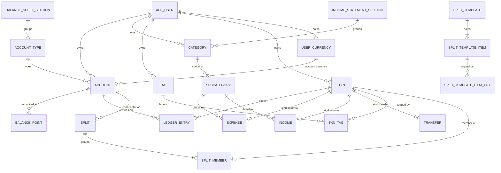
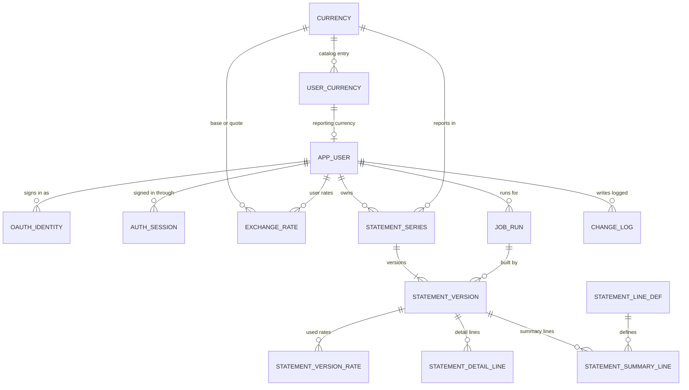

# RedBooks 0.2.0 - Data Model

This doc defines every entity of the RedBooks `0.2.0` PostgreSQL database: its columns, data types, keys, constraints, ownership and relations, and the API resource it backs. It is design topic 04.05 of the **release milestones**. The entities follow from the **workflows**, the **data flows**, the **accounting rules** and the **financial statements design**, and the same model is the contract for the schema build and for the API routes of topic 04.15.

## Contents

- [Summary](#summary)
- [References](#references)
- [Entity list](#entity-list)
- [Entity-relationship overview](#entity-relationship-overview)
- [Model decisions](#model-decisions)
- [Conventions](#conventions)
- [Identity](#identity)
- [Currency](#currency)
- [Books](#books)
- [Ledger](#ledger)
- [Splits](#splits)
- [Statements](#statements)
- [Operations](#operations)
- [Cross-table invariants](#cross-table-invariants)
- [Derived read models](#derived-read-models)
- [Traceability](#traceability)
- [Handoffs](#handoffs)

## Summary

01. **one general ledger of account entries.** Every movement on an account is one signed `ledger_entry`, per AR.01 of the **accounting rules**. The income and expense side lives on the expense and income records, which name the subcategory, and the opening balance equity side is implicit in the opening entry.
02. **a transaction header with one subtype per kind.** Every expense, income record, transfer and opening balance is a `txn` row, with its own subtype table for the fields of its kind. Tags, the change log, the transaction list and the split membership all point at the one header.
03. **entry roles tie each entry to its transaction.** An expense or income record owns one entry in role `account`, a transfer owns one `from` and one `to` entry, and an opening balance owns one `opening` entry. No transaction holds two entries on one account, so a transfer always moves between two different accounts.
04. **a split is its own model over ordinary transactions.** A `split` header names its date, currency, payee and hidden cost center, and every date of a split falls in one calendar month. Its payment sources are transfers with the cost center, and its category lines are expense and income records on the cost center, each a full transaction joined to the split through `split_member`. Split templates hold saved rows in their own tables and post nothing.
05. **a statement series holds versions.** A `statement_series` is one user, month and reporting currency. Each run writes a `statement_version` in its series, unique by its valid from time, numbered within the series, and current while its valid to time is empty. The version owns the detail lines, summary lines and rates of both statements.
06. **ownership is in every key.** Every user-owned table carries `owner_id`, and every foreign key between user-owned tables includes it, so the database rejects a row that points at another user's row.
07. **derived values stay derived.** Balances, running balances, tag balances, opening dates, year stale markers and the presentation view are computed on read. The stored statement lines are the one authority for what a statement said when it ran.

## References

- **release notes**: [020-release.md](../020-release.md)
- **release milestones**: [020-release-milestones.md](../020-release-milestones.md)
- **accounting rules**: [accounting-rules.md](accounting-rules.md)
- **financial statements design**: [financial-statements.md](financial-statements.md)
- **workflows**: [workflows.md](workflows.md)
- **data flows**: [data-flows.md](data-flows.md)
- **front end pages**: [front-end-pages.md](front-end-pages.md)
- **data migration**: [data-migration.md](data-migration.md)
- **homebudget data review**: [homebudget-data-review.md](homebudget-data-review.md)
- **test cases**: [test-cases.md](test-cases.md)
- **lessons learned**: [easymcf-lessons-learned.md](easymcf-lessons-learned.md)
- **easyMCF data model**: `easymcf/docs/design/data-model.md`, the layout reference for this doc
- **financial-statements data model**: `financial-statements/docs/releases/010/requirements/data-model.md`
- **postgresql skill**: `.claude/skills/postgresql/SKILL.md`

## Entity list

Each entity is one table. The API column names the resource of the **front end pages** API calls table that reads or writes it. A dash marks a table the API never exposes.

| id    | entity                     | area       | holds                               | api resource           |
| ----- | -------------------------- | ---------- | ----------------------------------- | ---------------------- |
| EN.01 | `app_user`                 | identity   | a person and their settings         | `/me`, `/settings`     |
| EN.02 | `oauth_identity`           | identity   | a provider subject of a user        | -                      |
| EN.03 | `auth_session`             | identity   | a signed-in browser session         | -                      |
| EN.04 | `currency`                 | currency   | the rate API currency catalog       | `/currencies/catalog`  |
| EN.05 | `user_currency`            | currency   | a currency a user holds             | `/currencies`          |
| EN.06 | `exchange_rate`            | currency   | a fetched or user rate              | `/rates`               |
| EN.07 | `balance_sheet_section`    | books      | the net worth sections, seeded      | `/account-types`       |
| EN.08 | `account_type`             | books      | the eight account types, seeded     | `/account-types`       |
| EN.09 | `account`                  | books      | an asset, liability or cost center  | `/accounts`            |
| EN.10 | `balance_point`            | books      | a reconciled balance on a date      | `/accounts/:id/...`    |
| EN.11 | `income_statement_section` | books      | the five statement sections, seeded | `/categories`          |
| EN.12 | `category`                 | books      | an income or expense category       | `/categories`          |
| EN.13 | `subcategory`              | books      | a detail line under a category      | `/categories`          |
| EN.14 | `tag`                      | books      | a label for providers and people    | `/tags`                |
| EN.15 | `txn`                      | ledger     | the header of every transaction     | `/transactions`        |
| EN.16 | `ledger_entry`             | ledger     | a signed entry on one account       | `/accounts/:id/ledger` |
| EN.17 | `expense`                  | ledger     | an expense or refund                | `/expenses`            |
| EN.18 | `income`                   | ledger     | an income record                    | `/income`              |
| EN.19 | `transfer`                 | ledger     | a move between two accounts         | `/transfers`           |
| EN.20 | `txn_tag`                  | ledger     | a tag on a transaction              | tags on each record    |
| EN.21 | `split`                    | splits     | one event across accounts           | `/splits`              |
| EN.22 | `split_member`             | splits     | a source or line of a split         | `/splits`              |
| EN.23 | `split_template`           | splits     | a saved split form                  | `/split-templates`     |
| EN.24 | `split_template_item`      | splits     | a row of a template                 | `/split-templates`     |
| EN.25 | `split_template_item_tag`  | splits     | a tag on a template row             | `/split-templates`     |
| EN.26 | `statement_line_def`       | statements | the fixed statement lines, seeded   | `/statements`          |
| EN.27 | `statement_series`         | statements | a user, month and currency          | `/snapshots`           |
| EN.28 | `statement_version`        | statements | one run of a series                 | `/snapshots`           |
| EN.29 | `statement_version_rate`   | statements | a month-end rate a version used     | `/statements`          |
| EN.30 | `statement_detail_line`    | statements | a line read from the ledger         | `/statements`          |
| EN.31 | `statement_summary_line`   | statements | a total or derived line             | `/statements`          |
| EN.32 | `change_log`               | operations | before and after of each write      | `/snapshots/changes`   |
| EN.33 | `job_run`                  | operations | a background run and its status     | `/jobs/:id`            |
| EN.34 | `schema_meta`              | operations | the schema version marker           | -                      |

01. **EN.10** the balance points read under `/accounts/:id/balance-points`, per PG.04 of the **front end pages**.
02. **EN.13** subcategories write through `/categories/:id/subcategories` and read nested under their category. Topic 04.15 fixes the final path.
03. **EN.07, EN.08, EN.11 and EN.26** are seeded vocabularies. The API serves them read-only so the forms and the presentation view need no hardcoded lists.

## Entity-relationship overview

The books, ledger and splits:



Identity, currency, statements and operations:



## Model decisions

01. **DM.01 a single ledger of account entries.** The user settled a single general ledger with separate expense, income and transfer models, per requirements audit item 01.04.03 of the **release milestones**. A `ledger_entry` row is the account side of a transaction. The category side is the subcategory on the expense or income record, with the same signed amount in the account's currency, so AR.02 balances by construction: the record's amount and its entry's amount are one value. Opening balance equity has no row. Its balance is the sum of the opening entries, per AR.10.
02. **DM.02 the transaction header.** The transaction list, tags, splits, drill downs and the change log each need one reference to "a transaction" of any kind. The `txn` header gives it, and the subtype tables `expense`, `income` and `transfer` carry the fields of each kind, keyed by the header's id. Each subtype is the table behind its own API resource.
03. **DM.03 entries hang from their transaction.** Each entry names its transaction, its role and its account. A unique role per transaction gives a transfer exactly one `from` and one `to` entry, and a unique account per transaction keeps the two on different accounts. The entry date and owner follow the header through a cascading composite foreign key, so the header is the one authority for both.
04. **DM.04 the split model.** A split owns a header and its members. Each member is an ordinary transaction, so a payment source is a real transfer that the account ledger and the account statement both see, and a category line is a real expense or income record that the income statement and its drill down both see, per AR.07 and WF.09. The membership table holds the order of the rows and their kind. The cost center is the account of type `clearing`, one per user and currency, that every picker and the balance sheet leave out. It holds 0.00 at every month end, since no split crosses a month boundary.
05. **DM.05 statement series and versions.** The series is the natural key of a statement month: user, month and reporting currency. It exists once, carries the id the history and the version list read by, and is the row a run locks to number its version. A version is one run, a slowly changing dimension of type 2: valid from its run time, valid to the run time of the version after it, and current while valid to is empty. Its current flag is generated from valid to, and a partial unique index allows one current version per series.
06. **DM.06 statement lines are immutable facts.** Detail and summary lines are written once with their version, per the statement data model of the **financial statements design**. Their line keys are generated from their ids, so a key can never drift from the item it names. A stale marker lives on the version as the time it went stale.
07. **DM.07 ownership through composite keys.** Every user-owned table has a unique key on `owner_id, id`, and every reference to it carries the owner. A cross-user reference fails at the database, and every query filters by `owner_id`, per flow rule 03 of the **data flows**.
08. **DM.08 retire over delete.** Accounts, categories, subcategories, tags and split templates carry `is_active`. A row that a transaction, a balance point or a statement line references is retired, and the references from history use `ON DELETE RESTRICT`.
09. **DM.09 one match key column.** Each record the seed or the migration loads carries its source key in `match_key`, unique per owner, per the upsert match keys of the **homebudget data review**. A record entered in the app has none.

> **implementation decision**: vocabularies that carry attributes, such as an account type's section or a line's label and parent, are seeded tables. State values with no attributes, such as a run kind or a job status, are `text` columns with a `CHECK` list. Both follow the seeded vocabulary rule of the **postgresql skill**.

## Conventions

These conventions apply to every entity below. The entity tables list only the columns particular to each entity.

01. **names.** Tables and columns are `snake_case` and singular. The user table is `app_user`, since `user` is reserved in PostgreSQL.
02. **keys.** Every `id` is `bigint GENERATED ALWAYS AS IDENTITY PRIMARY KEY` unless the entity states another key.
03. **ownership.** Every user-owned table has `owner_id bigint NOT NULL REFERENCES app_user (id) ON DELETE CASCADE` and `UNIQUE (owner_id, id)`. A rule of "FK `account`, owned" means a composite foreign key on `owner_id` and the column, referencing the unique key of that table.
04. **money.** Amounts are `numeric(19, 4)` and signed by their contribution to net worth, per AR.01. Each stored amount is rounded half up to its currency's decimal places, per AR.12 item 01. Rates are `numeric(20, 10)` and always positive. Currency codes are `char(3)` ISO 4217 codes.
05. **dates and times.** A calendar date, such as an entry date, is `date` in the user's timezone. A moment, such as a run time, is `timestamptz` stored in UTC.
06. **audit times.** Every mutable table also has `created_at` and `updated_at`, both `timestamptz NOT NULL DEFAULT now()`. An append-only table has `created_at` only, as each entity states.
07. **retire flag.** `is_active boolean NOT NULL DEFAULT true`, per DM.08.
08. **match key.** `match_key text NULL`, with `UNIQUE (owner_id, match_key)` where it is not null. Its value is `hb02:<table>:<device id>:<device key>` for an account `02` row, MK.01, or `hb01:<table>:<primary key>` for an account `01` row, MK.02.
09. **API types.** `bigint` travels as a JSON integer, `numeric` as a decimal string, `date` as `YYYY-MM-DD`, `timestamptz` as ISO 8601 in UTC, and a `text` vocabulary value as its string. `owner_id` never travels: the API takes it from the session. Generated columns and derived values are read-only.

## Identity

### `app_user`

A person who signs in. Every other user-owned row belongs to one user. The seed creates two users with distinct data, per database criterion 03 of the OAuth login milestone.

| id | column                  | type        | null | rule                                   |
| -- | ----------------------- | ----------- | ---- | -------------------------------------- |
| 01 | id                      | bigint      | no   | PK                                     |
| 02 | email                   | text        | no   | unique, stored lowercase               |
| 03 | display_name            | varchar(80) | no   | from the provider at first sign-in     |
| 04 | timezone                | text        | no   | default `Asia/Singapore`, see note 01  |
| 05 | reporting_currency_code | char(3)     | yes  | FK `user_currency`, owned, see note 02 |

01. **timezone** holds an IANA name. `CHECK (is_iana_timezone(timezone))` calls a SQL function that looks the name up in `pg_timezone_names`, so the database rejects any other name, per WF.19 and DF.20.
02. **reporting_currency_code** is null until the user holds a currency, per WF.02. The composite key `id, reporting_currency_code` references `user_currency (owner_id, currency_code)` with `ON DELETE RESTRICT`, so a reporting currency stays in the user's list, per WF.02.03.
03. **API**: `GET /me` returns the id, email and display name. `GET` and `PATCH /settings` read and write the timezone, and `PUT /settings/reporting-currency` starts WF.18.

### `oauth_identity`

A provider subject linked to a user, found or created at the callback, per DF.01.

| id | column          | type         | null | rule                                |
| -- | --------------- | ------------ | ---- | ----------------------------------- |
| 01 | id              | bigint       | no   | PK                                  |
| 02 | user_id         | bigint       | no   | FK `app_user`, cascades on delete   |
| 03 | provider        | varchar(40)  | no   | the provider's issuer name          |
| 04 | subject         | varchar(255) | no   | unique with provider                |
| 05 | email           | text         | yes  | the email claim at the last sign-in |
| 06 | last_sign_in_at | timestamptz  | no   | set at each callback                |

01. the provider's tokens are used once at the callback and never stored, per DS.02 of the **data flows**.

### `auth_session`

A signed-in browser session. A row per sign-in, deleted at sign-out and purged after expiry. The browser cookie holds the token, and the row holds its digest.

| id | column       | type        | null | rule                                     |
| -- | ------------ | ----------- | ---- | ---------------------------------------- |
| 01 | id           | bigint      | no   | PK                                       |
| 02 | user_id      | bigint      | no   | FK `app_user`, cascades on delete        |
| 03 | token_hash   | bytea       | no   | unique, SHA-256 of the session token     |
| 04 | expires_at   | timestamptz | no   | the session is valid while now is before |
| 05 | last_seen_at | timestamptz | no   | refreshed on each request                |

01. append-only apart from `last_seen_at`. It has `created_at` and no `updated_at`.

## Currency

### `currency`

The catalog of every currency the rate API supports, shared by every user, per DF.02.

| id | column         | type        | null | rule                                     |
| -- | -------------- | ----------- | ---- | ---------------------------------------- |
| 01 | code           | char(3)     | no   | PK, ISO 4217 code                        |
| 02 | name           | varchar(80) | no   | from the rate API currency list          |
| 03 | decimal_places | smallint    | no   | `CHECK (decimal_places BETWEEN 0 AND 4)` |
| 04 | is_active      | boolean     | no   | false once the rate API drops it         |

01. **decimal_places** comes from the ISO 4217 table, and sets the rounding of every amount in the currency.
02. **API**: `GET /currencies/catalog` lists the active catalog for the add currency search.

### `user_currency`

A currency a user holds, following the HomeBudget currency record, per database criterion 02 of the currency model milestone.

| id | column        | type        | null | rule                            |
| -- | ------------- | ----------- | ---- | ------------------------------- |
| 01 | owner_id      | bigint      | no   | PK with currency_code           |
| 02 | currency_code | char(3)     | no   | FK `currency`                   |
| 03 | name          | varchar(80) | no   | defaults to the catalog name    |
| 04 | locale        | varchar(20) | yes  | display locale, such as `en_SG` |

01. the primary key `owner_id, currency_code` lets a user hold a currency once, and is the target of every owned currency reference.
02. an account or the reporting currency setting referencing the row blocks its removal through `ON DELETE RESTRICT`, and the API names what still uses it, per WF.02.03.
03. **API**: `GET` and `POST /currencies`, `DELETE /currencies/:code`.

### `exchange_rate`

A rate for an ordered currency pair on a date. A fetched rate is shared by every user. A user rate belongs to one user and takes the place of the fetched rate in every conversion for that user, per WF.03 and DF.04.

| id | column         | type           | null | rule                                     |
| -- | -------------- | -------------- | ---- | ---------------------------------------- |
| 01 | id             | bigint         | no   | PK                                       |
| 02 | owner_id       | bigint         | yes  | FK `app_user`, set only for a user rate  |
| 03 | base_currency  | char(3)        | no   | FK `currency`                            |
| 04 | quote_currency | char(3)        | no   | FK `currency`, differs from base         |
| 05 | rate_date      | date           | no   | the date the rate serves                 |
| 06 | rate           | numeric(20,10) | no   | `CHECK (rate > 0)`, quote units per base |
| 07 | source         | text           | no   | one of `fetched`, `user`                 |
| 08 | published_date | date           | yes  | see note 02                              |
| 09 | fetched_at     | timestamptz    | yes  | set for a fetched rate                   |

01. **source and owner agree**: `CHECK ((source = 'fetched') = (owner_id IS NULL))`. A fetched rate is unique on `base_currency, quote_currency, rate_date` where `source = 'fetched'`, and a user rate on `owner_id, base_currency, quote_currency, rate_date` where `source = 'user'`. Both are partial unique indexes, per database criterion 04 of the currency model milestone.
02. **published_date** is the date of the published rate a fetched row took. It equals `rate_date` on a business day, and is the last published date before it on a weekend or holiday, per WF.03.05.
03. a rate typed on one transaction stays on that record's `rate` column and never writes here, per DF.05.
04. **API**: `GET /rates` lists the stored rates for the user, its own and the fetched ones. `POST /rates` and `DELETE /rates/:id` write user rates only. `GET /rates/lookup?from=&to=&date=` resolves a rate through DF.04.

## Books

### `balance_sheet_section`

The seeded net worth sections of the balance sheet, NW.02 to NW.06 of the **financial statements design**.

| id | column      | type        | null | rule                                        |
| -- | ----------- | ----------- | ---- | ------------------------------------------- |
| 01 | code        | text        | no   | PK                                          |
| 02 | name        | varchar(40) | no   | the section's name                          |
| 03 | parent_code | text        | yes  | FK self, `liquid` for the three liquid ones |
| 04 | sort_order  | smallint    | no   | layout order                                |

01. the seeded rows are `illiquid_retirement`, `liquid`, `cash_bank`, `liquid_investments` and `credit`, in that order. `liquid` is the parent of the last three and holds no account type.

### `account_type`

The eight seeded account types, TY.01 to TY.08 of the **financial statements design**. The type is the balance sheet subsection, and each type belongs to one section at any balance.

| id | column        | type        | null | rule                                       |
| -- | ------------- | ----------- | ---- | ------------------------------------------ |
| 01 | code          | text        | no   | PK                                         |
| 02 | name          | varchar(40) | no   | the type's name                            |
| 03 | section_code  | text        | no   | FK `balance_sheet_section`, a leaf section |
| 04 | is_subsection | boolean     | no   | false for investment and retirement        |
| 05 | sort_order    | smallint    | no   | order within its section                   |
| 06 | has_line      | boolean     | no   | false for `clearing`, see note 03          |

01. the seeded codes are `wallet_cash`, `bank_account` and `clearing` in `cash_bank`, `credit_card`, `other_credit` and `margin_credit` in `credit`, `investment` in `liquid_investments`, and `retirement` in `illiquid_retirement`.
02. **is_subsection** marks the types that show a subsection total, LK.07. The investment and retirement types are their own section with no subsection.
03. **has_line** is false for `clearing` only. The cost center holds 0.00 at every month end, so the balance sheet shows no account line or subsection for it, and CK.06 fails a build where it does not, per the **financial statements design**.
04. **API**: `GET /account-types` returns the types with their sections, for the account form and the account list groups.

### `account`

An asset or liability the user tracks, in or outside net worth, including the hidden cost center of each currency.

| id | column            | type        | null | rule                                     |
| -- | ----------------- | ----------- | ---- | ---------------------------------------- |
| 01 | id                | bigint      | no   | PK                                       |
| 02 | owner_id          | bigint      | no   | FK `app_user`                            |
| 03 | name              | varchar(80) | no   | unique among the owner's active accounts |
| 04 | currency_code     | char(3)     | no   | FK `user_currency`, owned                |
| 05 | in_net_worth      | boolean     | no   | default true                             |
| 06 | account_type_code | text        | yes  | FK `account_type`, see note 01           |
| 07 | sort_order        | integer     | no   | the user's account order                 |
| 08 | is_active         | boolean     | no   | retire flag                              |
| 09 | match_key         | text        | yes  | MK.01 or MK.02                           |

01. **type and net worth agree**: `CHECK (in_net_worth = (account_type_code IS NOT NULL))`. An account in net worth has a type, and one outside net worth, such as a counterparty, has none, per WF.04.02 and AC.01 of the **data migration**. CK.05 then holds by constraint.
02. **currency is fixed once posted.** The account has `UNIQUE (owner_id, id, currency_code)`, and every ledger entry references it with `ON UPDATE RESTRICT`, so the database rejects a currency change on an account with entries, per WF.04.05 and database criterion 06 of the txn and accounts milestone.
03. **the cost center is the `clearing` type.** A partial unique index on `owner_id, currency_code` where `account_type_code = 'clearing'` allows one cost center per user and currency, per AR.07 item 06. The ledger service creates it on the first split in a currency, per DF.21, and the account `01` cost centers of each currency map onto it, per task 12.03 of the **data migration**. Every picker, form and the account list leave out the `clearing` type, and the balance sheet shows no line for it, per `account_type` note 03.
04. **name uniqueness** is a partial unique index on `owner_id, name` where `is_active`, per PG.05.
05. the opening balance and opening date are derived from the account's opening entry, per [Derived read models](#derived-read-models), and are never columns here.
06. **API**: CRUD on `/accounts`, `POST /accounts/:id/retire` and `/restore`, and `GET /accounts?include=balance`. Creating an account takes its balance and balance date, its reconciled balance point, in the same request, and a later edit of either writes a new current point, per DF.06. Delete succeeds only for an account that no entry other than its opening entry, no split and no statement line references, and retire covers every other case.

### `balance_point`

A reconciled balance on any date, confirmed against an independent source. An account has exactly one current point at any time, and every balance of the account, before or after the point's date, derives from it and the signed entries, per AR.11. A new point replaces the current one, and the replaced point stays as history, a slowly changing dimension of type 2 like the statement versions.

| id | column     | type          | null | rule                                    |
| -- | ---------- | ------------- | ---- | --------------------------------------- |
| 01 | id         | bigint        | no   | PK                                      |
| 02 | owner_id   | bigint        | no   | FK `app_user`                           |
| 03 | account_id | bigint        | no   | FK `account`, owned, cascades on delete |
| 04 | point_date | date          | no   | any date, see note 02                   |
| 05 | balance    | numeric(19,4) | no   | signed, in the account currency         |
| 06 | source     | text          | no   | one of `user`, `seed`, `migration`      |
| 07 | valid_from | timestamptz   | no   | when the point became current           |
| 08 | valid_to   | timestamptz   | yes  | when a new point replaced it            |
| 09 | is_current | boolean       | no   | generated as `valid_to IS NULL`         |

01. **one current point per account**: a partial unique index on `account_id` where `valid_to IS NULL`, and `CHECK (valid_to IS NULL OR valid_to > valid_from)`. A new point sets the current one's `valid_to` to its own `valid_from` in the same database transaction. The ledger service keeps exactly one current point on every account, IV.01.
02. **any date.** `point_date` can sit before, among or after the account's entries, and a history row can carry any date too. The history records what the point was at each time, so it explains a past statement version built from an earlier point.
03. **upsert.** The seed and the migration match the current point by account and date, MK.03 of the **homebudget data review**. A reload with the same date and balance skips it, and any other value writes a new current point.
04. the account `01` migration replaces each paired account's current point with its last account `01` point, and the account `02` point becomes history, per MR.10 of the **data migration**.
05. **API**: `GET /accounts/:id/balance-points` returns the current point, then the history newest first by `valid_from`, read-only in `0.2.0`, per the implementation decision of WF.04. A new point is written through the account form.

### `income_statement_section`

The five seeded sections, IS.01 to IS.05 of the **financial statements design**.

| id | column     | type        | null | rule               |
| -- | ---------- | ----------- | ---- | ------------------ |
| 01 | code       | text        | no   | PK                 |
| 02 | name       | varchar(40) | no   | the section's name |
| 03 | sort_order | smallint    | no   | layout order       |

01. the seeded codes are `personal`, `investment`, `rental`, `cole` and `discretionary`.

### `category`

The upper level of the two-level category model, with its required statement section.

| id | column       | type        | null | rule                                   |
| -- | ------------ | ----------- | ---- | -------------------------------------- |
| 01 | id           | bigint      | no   | PK                                     |
| 02 | owner_id     | bigint      | no   | FK `app_user`                          |
| 03 | name         | varchar(80) | no   | unique per owner and kind among active |
| 04 | kind         | text        | no   | one of `income`, `expense`             |
| 05 | section_code | text        | no   | FK `income_statement_section`, note 01 |
| 06 | sort_order   | integer     | no   | order within its section               |
| 07 | is_active    | boolean     | no   | retire flag                            |
| 08 | match_key    | text        | yes  | MK.01 or MK.02                         |

01. **the section fits the kind**: `CHECK (kind = 'expense' OR section_code IN ('personal', 'investment'))`, per the category kind column of the income statement sections table.
02. `UNIQUE (owner_id, id, kind)` is the target of the subcategory reference, so a category's kind cannot change while it holds subcategories.
03. every user is seeded with the investment P and L categories IP.01 to IP.07 and the personal income categories PS.01 to PS.09, per the **financial statements design**.
04. **API**: CRUD on `/categories`, `POST /categories/:id/retire`, and month totals per category, per AC.06 of the **front end pages**. The list takes `?kind=`.

### `subcategory`

A detail line of the income statement. Every expense and income record names one, per WF.05.

| id | column      | type        | null | rule                                    |
| -- | ----------- | ----------- | ---- | --------------------------------------- |
| 01 | id          | bigint      | no   | PK                                      |
| 02 | owner_id    | bigint      | no   | FK `app_user`                           |
| 03 | category_id | bigint      | no   | FK `category` with kind, owned          |
| 04 | kind        | text        | no   | equals its category's kind, see note 01 |
| 05 | name        | varchar(80) | no   | unique within its category among active |
| 06 | sort_order  | integer     | no   | order within its category               |
| 07 | is_active   | boolean     | no   | retire flag                             |
| 08 | match_key   | text        | yes  | MK.01 or MK.02                          |

01. **kind** is copied from the category and held equal by the composite foreign key `owner_id, category_id, kind` to `category (owner_id, id, kind)`. A move to another category of the same kind passes, and a move to the other kind fails, per WF.05.05.
02. `UNIQUE (owner_id, id, kind)` is the target of the expense and income references, so an expense always names an expense subcategory.
03. **API**: written through `/categories/:id/subcategories`, with `PATCH` to rename or move and `POST .../retire`.

### `tag`

An optional label on transactions, such as a provider on a pooled bills account or a person on a pooled friends account, per AR.08.

| id | column    | type        | null | rule                                   |
| -- | --------- | ----------- | ---- | -------------------------------------- |
| 01 | id        | bigint      | no   | PK                                     |
| 02 | owner_id  | bigint      | no   | FK `app_user`                          |
| 03 | name      | varchar(60) | no   | unique per owner among active, note 01 |
| 04 | is_active | boolean     | no   | retire flag                            |

01. uniqueness is a partial unique index on `owner_id, lower(name)` where `is_active`, per DF.22.
02. a merge moves every `txn_tag` and `split_template_item_tag` row to the other tag and deletes this one, in one database transaction.
03. **API**: CRUD on `/tags`, `POST /tags/:id/merge`, `POST /tags/:id/retire`, and `GET /tags/:id/balances`. A record's `tags` field accepts names, and an unknown name creates the tag, per DF.08.

## Ledger

### `txn`

The header of every transaction. The kind picks the subtype table that holds its fields.

| id | column    | type   | null | rule                                              |
| -- | --------- | ------ | ---- | ------------------------------------------------- |
| 01 | id        | bigint | no   | PK                                                |
| 02 | owner_id  | bigint | no   | FK `app_user`                                     |
| 03 | kind      | text   | no   | one of `expense`, `income`, `transfer`, `opening` |
| 04 | txn_date  | date   | no   | the date of every entry it owns                   |
| 05 | notes     | text   | yes  | free text                                         |
| 06 | match_key | text   | yes  | MK.01 or MK.02                                    |

01. `UNIQUE (owner_id, id, kind)` is the target of every subtype and of `split_member`, and `UNIQUE (owner_id, id, kind, txn_date)` is the target of `ledger_entry`, so an entry always carries its header's kind and date.
02. **kind is fixed** once written. An edit that changes an expense into a transfer deletes the transaction and writes a new one.
03. **opening** transactions are written only by the ledger service, one per account, per AR.10. They never appear in the transaction list.
04. index `owner_id, txn_date, id` serves the transaction list, ordered by date and then id, per LL.15 of the **lessons learned**.
05. **API**: `GET /transactions` lists headers of kind expense, income and transfer joined to their subtype, entries and tags, filtered by account, category, subcategory, tag and date range. `GET /transactions.csv` exports the same rows. Writes go through the subtype resources.

### `ledger_entry`

A signed entry on one account, the account side of a transaction, per AR.01 and DM.01.

| id | column        | type          | null | rule                                      |
| -- | ------------- | ------------- | ---- | ----------------------------------------- |
| 01 | id            | bigint        | no   | PK                                        |
| 02 | owner_id      | bigint        | no   | FK `app_user`                             |
| 03 | txn_id        | bigint        | no   | FK `txn`, see note 01                     |
| 04 | txn_kind      | text          | no   | follows the header, see note 01           |
| 05 | entry_date    | date          | no   | follows the header, see note 01           |
| 06 | entry_role    | text          | no   | one of `account`, `from`, `to`, `opening` |
| 07 | account_id    | bigint        | no   | FK `account` with currency, owned         |
| 08 | currency_code | char(3)       | no   | equals the account's currency, note 02    |
| 09 | amount        | numeric(19,4) | no   | signed, in the account currency, note 03  |

01. **the header is the authority.** The composite foreign key `owner_id, txn_id, txn_kind, entry_date` references `txn (owner_id, id, kind, txn_date)` with `ON UPDATE CASCADE ON DELETE CASCADE`. A date edit on the header moves its entries, and deleting the header deletes them, per WF.10.04.
02. **the currency follows the account.** The composite foreign key `owner_id, account_id, currency_code` references `account (owner_id, id, currency_code)` with `ON UPDATE RESTRICT`, so the database rejects an entry whose currency differs from its account's, per database criterion 06 of the txn and accounts milestone.
03. **sign and role rules**, transcribed from AR.05 to AR.10:
    01. the role fits the kind: `account` for expense and income, `from` and `to` for a transfer, `opening` for an opening balance.
    02. `CHECK (entry_role <> 'from' OR amount < 0)` and `CHECK (entry_role <> 'to' OR amount > 0)`, per AR.09.
    03. `CHECK (amount <> 0 OR entry_role = 'opening')`. An opening balance of 0.00 still dates the account's opening.
04. **one role and one account per transaction**: `UNIQUE (txn_id, entry_role)` and `UNIQUE (txn_id, account_id)`. A transfer then holds one `from` and one `to` entry on two different accounts, per database criterion 03 of the txn and accounts milestone, and an account holds one opening entry through a partial unique index on `account_id` where `entry_role = 'opening'`.
05. index `account_id, entry_date, id` serves balances, the ledger page and the statement build.
06. append-only between writes of its transaction. It has `created_at` and no `updated_at`.
07. **API**: `GET /accounts/:id/ledger?month=&tag=` returns the month's entries with the running balance, per [Derived read models](#derived-read-models). Entries are never written directly.

### `expense`

An expense or a refund on an expense subcategory, posted on the account that paid or received it, per AR.05, AR.06 and WF.06.

| id | column           | type           | null | rule                                          |
| -- | ---------------- | -------------- | ---- | --------------------------------------------- |
| 01 | txn_id           | bigint         | no   | PK, FK `txn` of kind expense, cascades        |
| 02 | owner_id         | bigint         | no   | FK `app_user`                                 |
| 03 | subcategory_id   | bigint         | no   | FK `subcategory` of kind expense, owned       |
| 04 | entered_currency | char(3)        | no   | FK `user_currency`, owned                     |
| 05 | entered_amount   | numeric(19,4)  | no   | signed, `CHECK (entered_amount <> 0)`         |
| 06 | rate             | numeric(20,10) | no   | `CHECK (rate > 0)`, account units per entered |
| 07 | rate_kind        | text           | no   | see note 03                                   |
| 08 | payee            | varchar(120)   | yes  | the payee, null on a split line               |

01. the subtype keys `txn_kind` and `subcategory_kind` are stored generated columns fixed to `expense`, so the composite foreign keys to `txn (owner_id, id, kind)` and `subcategory (owner_id, id, kind)` admit only an expense header and an expense subcategory.
02. **sign.** The entered amount carries the sign of its entry: negative for a purchase, positive for a refund, per AR.05 and AR.06. The API's `refund` flag is derived from the sign, and the form's positive amount is signed at the API boundary, per the amounts convention of the **workflows**.
03. **rate_kind** is one of `same_currency`, `fetched`, `user_rate` and `override`. `CHECK (rate_kind <> 'same_currency' OR rate = 1)`. It records where the rate came from, so the detail page can show an override, per WF.06.04.
04. the ledger amount is `round(entered_amount × rate)` to the account currency's decimal places, IV.04. The record and its one `account` entry are written together.
05. **API**: CRUD on `/expenses`. A request carries the date, account, subcategory, amount, refund flag, currency, rate or account amount override, payee, notes and tags. A response adds the account amount from the entry and the split id when the expense is a split line.

### `income`

An income record, or its reversal, on an income subcategory, posted on the account that received it, per AR.06 and WF.07.

| id | column           | type           | null | rule                                          |
| -- | ---------------- | -------------- | ---- | --------------------------------------------- |
| 01 | txn_id           | bigint         | no   | PK, FK `txn` of kind income, cascades         |
| 02 | owner_id         | bigint         | no   | FK `app_user`                                 |
| 03 | subcategory_id   | bigint         | no   | FK `subcategory` of kind income, owned        |
| 04 | entered_currency | char(3)        | no   | FK `user_currency`, owned                     |
| 05 | entered_amount   | numeric(19,4)  | no   | signed, `CHECK (entered_amount <> 0)`         |
| 06 | rate             | numeric(20,10) | no   | `CHECK (rate > 0)`, account units per entered |
| 07 | rate_kind        | text           | no   | as `expense` note 03                          |

01. `income` follows every rule of `expense` with kind `income`. It has no payee, per PG.11 of the **front end pages**.
02. **API**: CRUD on `/income`.

### `transfer`

A move between two of the user's own accounts, neither income nor expense, per AR.09 and WF.08. Its amounts are its two entries.

| id | column     | type           | null | rule                                       |
| -- | ---------- | -------------- | ---- | ------------------------------------------ |
| 01 | txn_id     | bigint         | no   | PK, FK `txn` of kind transfer, cascades    |
| 02 | owner_id   | bigint         | no   | FK `app_user`                              |
| 03 | rate       | numeric(20,10) | no   | `CHECK (rate > 0)`, to units per from unit |
| 04 | rate_kind  | text           | no   | as `expense` note 03                       |
| 05 | typed_side | text           | no   | one of `from`, `to`, `both`, see note 02   |

01. the `from` entry holds the amount sent, negative, in the sending account's currency, and the `to` entry the amount received, positive, in the receiving account's currency. A same-currency transfer has `rate_kind = 'same_currency'`, rate 1 and two equal magnitudes.
02. **typed_side** records which amount the user typed, so an edit recomputes the other side, per AR.12 item 04. With `from` or `to`, the other side is the typed side converted at the rate and rounded half up. With `both`, as for a bank conversion typed from the statement, the two amounts are the authority and the rate is their ratio at full stored precision.
03. index on the entries' `account_id` serves both sides, so no account column is copied here.
04. **API**: CRUD on `/transfers`. A request carries the date, from and to accounts, the typed amount or both amounts, a rate override, notes and tags. A response adds both accounts and amounts from the entries, and the split id when the transfer is a payment source.

### `txn_tag`

A tag on a transaction. A transfer's tags apply to both of its entries, and each split member carries its own, per WF.20.01.

| id | column   | type   | null | rule                                |
| -- | -------- | ------ | ---- | ----------------------------------- |
| 01 | owner_id | bigint | no   | FK `app_user`                       |
| 02 | txn_id   | bigint | no   | FK `txn`, owned, cascades on delete |
| 03 | tag_id   | bigint | no   | FK `tag`, owned, restricts delete   |

01. the primary key is `txn_id, tag_id`. Index `tag_id, txn_id` serves the tag detail and the tag filter.
02. append-only. It has `created_at` only.
03. **API**: the `tags` field of every expense, income, transfer and split member.

## Splits

The split model records one event across several accounts and categories, per AR.07 and WF.09. A split saves only when its payment sources less its category lines come to 0.00 in its currency, IV.07.

```text
split  (date, currency, payee, notes, cost center)
│
├── split_member  kind source  →  txn kind transfer
│   └── ledger_entry  from or to  on the payment account
│   └── ledger_entry  to or from  on the cost center
│
└── split_member  kind line    →  txn kind expense or income
    └── ledger_entry  account     on the cost center
```

### `split`

The header of a split.

| id | column                 | type         | null | rule                                |
| -- | ---------------------- | ------------ | ---- | ----------------------------------- |
| 01 | id                     | bigint       | no   | PK                                  |
| 02 | owner_id               | bigint       | no   | FK `app_user`                       |
| 03 | split_date             | date         | no   | the date of every line, note 02     |
| 04 | currency_code          | char(3)      | no   | the cost center's currency, note 01 |
| 05 | cost_center_account_id | bigint       | no   | FK `account`, see note 01           |
| 06 | payee                  | varchar(120) | yes  | shown on every payment source row   |
| 07 | notes                  | text         | yes  | free text                           |

01. **the cost center fits the split.** A stored generated column `cost_center_type`, fixed to `clearing`, joins `owner_id, cost_center_account_id, currency_code, cost_center_type` in one composite foreign key to `account (owner_id, id, currency_code, account_type_code)`. The split then always posts on the user's cost center for its own currency, per AR.07 item 06.
02. **one month.** Every category line is dated on `split_date`, and every payment source in the same calendar month, per AR.07 item 05. A split never crosses a month boundary, so its cost center is at 0.00 at every month end. `split_member` enforces the month by constraint.
03. **API**: CRUD on `/splits`. A request carries the header, the payment sources and the category lines in one body, and the ledger service writes the split, its member transactions and their entries in one database transaction, per DF.21. An edit replaces every member.

### `split_member`

A payment source or a category line of a split, each an ordinary transaction.

| id | column      | type     | null | rule                                              |
| -- | ----------- | -------- | ---- | ------------------------------------------------- |
| 01 | owner_id    | bigint   | no   | FK `app_user`                                     |
| 02 | split_id    | bigint   | no   | FK `split`, owned, restricts delete               |
| 03 | txn_id      | bigint   | no   | PK, FK `txn` with kind, owned, cascades on delete |
| 04 | txn_kind    | text     | no   | follows the header through the foreign key        |
| 05 | member_kind | text     | no   | generated, see note 01                            |
| 06 | position    | smallint | no   | row order within its kind                         |
| 07 | txn_date    | date     | no   | follows the member's header, note 05              |
| 08 | split_date  | date     | no   | follows the split, note 05                        |

01. **member_kind** is a stored generated column: `source` for a transfer and `line` for an expense or income record. `UNIQUE (split_id, member_kind, position)` orders the form's rows.
02. **a transaction joins at most one split**, through the primary key on `txn_id`.
03. **direction** is derived. A source is paid from its account when the cost center holds its `to` entry, and received into its account when the cost center holds its `from` entry.
04. **delete order.** The ledger service deletes the member transactions, which cascades their `split_member` rows, then deletes the split, per WF.10.04.
05. **the month rule holds by constraint.** `txn_date` joins the composite foreign key to `txn (owner_id, id, kind, txn_date)` and `split_date` the one to `split (owner_id, id, split_date)`, both `ON UPDATE CASCADE`. `CHECK (date_trunc('month', txn_date) = date_trunc('month', split_date))` then rejects any write, insert or cascaded edit, that puts a member in another month than its split.

### `split_template`

A saved split form, such as a monthly salary with its retirement fund sources, per WF.09.07. A template posts nothing.

| id | column        | type         | null | rule                          |
| -- | ------------- | ------------ | ---- | ----------------------------- |
| 01 | id            | bigint       | no   | PK                            |
| 02 | owner_id      | bigint       | no   | FK `app_user`                 |
| 03 | name          | varchar(80)  | no   | unique per owner among active |
| 04 | currency_code | char(3)      | no   | FK `user_currency`, owned     |
| 05 | payee         | varchar(120) | yes  | copied into a new split       |
| 06 | notes         | text         | yes  | copied into a new split       |
| 07 | is_active     | boolean      | no   | retire flag                   |

01. **API**: `GET` and `POST /split-templates`, `PATCH` and `DELETE /split-templates/:id`. A template holds no date, so a new split takes today and the template's rows.

### `split_template_item`

A payment source or category line row of a template, signed by the same rule as the records it becomes.

| id | column         | type          | null | rule                                   |
| -- | -------------- | ------------- | ---- | -------------------------------------- |
| 01 | id             | bigint        | no   | PK                                     |
| 02 | owner_id       | bigint        | no   | FK `app_user`                          |
| 03 | template_id    | bigint        | no   | FK `split_template`, owned, cascades   |
| 04 | item_kind      | text          | no   | one of `source`, `line`                |
| 05 | position       | smallint      | no   | unique with template and kind          |
| 06 | account_id     | bigint        | yes  | FK `account`, owned, a source only     |
| 07 | subcategory_id | bigint        | yes  | FK `subcategory`, owned, a line only   |
| 08 | amount         | numeric(19,4) | yes  | signed, `CHECK (amount <> 0)`, note 02 |

01. **the kind sets the columns**: a source has an account and no subcategory, and a line has a subcategory and no account, by `CHECK`.
02. **amount** is signed as the record the row becomes, per AR.01. A source carries the sign of its entry on the payment account: negative when paid from it, positive when received into it. A line carries the sign of its entered amount: negative for an expense, positive for a refund or for income. The direction and the refund toggle of PG.33 are derived from the sign, as for an expense. Null leaves the row for the user to fill.

### `split_template_item_tag`

A tag on a template row, copied onto the member transaction a new split writes.

| id | column   | type   | null | rule                                      |
| -- | -------- | ------ | ---- | ----------------------------------------- |
| 01 | owner_id | bigint | no   | FK `app_user`                             |
| 02 | item_id  | bigint | no   | FK `split_template_item`, owned, cascades |
| 03 | tag_id   | bigint | no   | FK `tag`, owned, restricts delete         |

01. the primary key is `item_id, tag_id`.

## Statements

A statement build writes one version of a series, per WF.15, DF.16 and the statement data model of the **financial statements design**. The tables store the lines of both statements for one month and nothing of their presentation, apart from the seeded definitions of the fixed lines.

```text
statement_series   one user, month and reporting currency
│
└── statement_version   one run: number, run kind, valid from, valid to
    ├── statement_version_rate   the month-end rates it used
    ├── statement_detail_line    LK.04, LK.05, LK.06, LK.08, LK.09, LK.10
    └── statement_summary_line   LK.01, LK.02, LK.03, LK.07
```

### `statement_line_def`

The seeded definitions of every fixed line key: the derived lines LK.01, the section totals LK.02, the subsection totals LK.07, and the view lines of PV.09. The presentation view reads labels, parents and order from here.

| id | column     | type        | null | rule                                       |
| -- | ---------- | ----------- | ---- | ------------------------------------------ |
| 01 | line_key   | text        | no   | PK, such as `is.sb01` or `is.section.cole` |
| 02 | statement  | text        | no   | one of `is`, `bs`                          |
| 03 | line_kind  | text        | no   | one of `total`, `derived`, `view`          |
| 04 | doc_id     | varchar(10) | no   | the design id, such as `SB.01`             |
| 05 | label      | varchar(80) | no   | the line's name in the layout              |
| 06 | parent_key | text        | yes  | FK self, the row it sits under             |
| 07 | sort_order | smallint    | no   | order beneath its parent                   |

01. `UNIQUE (line_key, line_kind)` is the target of the summary line reference, so a stored line keeps the kind its definition gives.
02. `CHECK (line_key LIKE statement || '.%')`.
03. a dynamic row, a category, subcategory, account or route, takes its parent from its item: a category from its section, an account from its type, per PV.07.

### `statement_series`

The natural key of a statement month, per DM.05 and DC.18 of the design tracker.

| id | column                  | type    | null | rule                              |
| -- | ----------------------- | ------- | ---- | --------------------------------- |
| 01 | id                      | bigint  | no   | PK                                |
| 02 | owner_id                | bigint  | no   | FK `app_user`                     |
| 03 | period_month            | date    | no   | the 1st of the month, see note 01 |
| 04 | reporting_currency_code | char(3) | no   | FK `currency`, see note 02        |

01. `CHECK (extract(day FROM period_month) = 1)`, and `UNIQUE (owner_id, period_month, reporting_currency_code)`.
02. the series references the catalog, not the user's list, so a user can remove an old reporting currency while its series stay in the history, per WF.18.
03. a run takes `SELECT ... FOR UPDATE` on its series row before it numbers and writes its version, so two runs of one series serialize.
04. append-only. It has `created_at` only.
05. **API**: `GET /snapshots` returns the history tree of DF.19 from the series and their current versions.

### `statement_version`

One run of a series, a slowly changing dimension of type 2.

| id | column           | type        | null | rule                                       |
| -- | ---------------- | ----------- | ---- | ------------------------------------------ |
| 01 | id               | bigint      | no   | PK                                         |
| 02 | owner_id         | bigint      | no   | FK `app_user`                              |
| 03 | series_id        | bigint      | no   | FK `statement_series`, owned               |
| 04 | version_number   | integer     | no   | `CHECK (version_number >= 1)`, see note 01 |
| 05 | run_kind         | text        | no   | see note 02                                |
| 06 | valid_from       | timestamptz | no   | the run time, unique with series           |
| 07 | valid_to         | timestamptz | yes  | the next version's run time, note 03       |
| 08 | is_current       | boolean     | no   | generated as `valid_to IS NULL`            |
| 09 | income_stale_at  | timestamptz | yes  | set when its income statement goes stale   |
| 10 | balance_stale_at | timestamptz | yes  | set when its balance sheet goes stale      |
| 11 | timezone         | text        | no   | the user's timezone the build used         |
| 12 | job_run_id       | bigint      | yes  | FK `job_run`                               |

01. `UNIQUE (series_id, version_number)` and `UNIQUE (series_id, valid_from)`. A run numbers its version one above the series' highest.
02. **run_kind** is one of `scheduled`, `migration`, `rerun` and `currency_change`, per WF.15, WF.16 and WF.18.
03. **one current version**: a partial unique index on `series_id` where `valid_to IS NULL`, and `CHECK (valid_to IS NULL OR valid_to > valid_from)`. A new version sets the old one's `valid_to` to its own `valid_from` in the same database transaction, per DF.18.
04. **stale times.** The ledger service sets them on the current version only, per DF.17, and a null value means fresh. A new version starts fresh, so a re-run clears the marker by becoming current, per WF.16.05.
05. **a failed check writes no version.** Its job run fails with the check's named cause, per the checks of the **financial statements design**.
06. the lines and rates of a version never change once written. Only `valid_to` and the stale times change.
07. **API**: `GET /snapshots/:series_id/versions` lists the versions with run time, run kind and validity. `POST /snapshots/rerun` and `POST /snapshots/regenerate` start a job, and `GET /snapshots/versions/:id/changes` reads the change log since `valid_from`, per WF.16.03.

### `statement_version_rate`

A month-end rate the version used, so a view can show its rate row and a reader can recompute every converted line.

| id | column           | type           | null | rule                                     |
| -- | ---------------- | -------------- | ---- | ---------------------------------------- |
| 01 | owner_id         | bigint         | no   | FK `app_user`                            |
| 02 | version_id       | bigint         | no   | FK `statement_version`, owned, cascades  |
| 03 | currency_code    | char(3)        | no   | FK `currency`, a foreign currency held   |
| 04 | rate_role        | text           | no   | one of `prior_month_end`, `month_end`    |
| 05 | rate_date        | date           | no   | the month-end date the rate serves       |
| 06 | rate             | numeric(20,10) | no   | reporting units per currency unit        |
| 07 | rate_source      | text           | no   | one of `fetched`, `user`                 |
| 08 | exchange_rate_id | bigint         | yes  | FK `exchange_rate`, `ON DELETE SET NULL` |

01. the primary key is `version_id, currency_code, rate_role`. `prior_month_end` is r_(N-1) and `month_end` is r_N, per the currency translation section of the **financial statements design**. For the current month, `month_end` is today's rate.
02. the rate value is copied, so a later user rate change leaves the version's figures explained.
03. append-only. It has `created_at` only.

### `statement_detail_line`

A line read from the ledger: the detail kind SM.01 of the **financial statements design**, one row per DL.01 to DL.09 line.

| id | column                 | type          | null | rule                                      |
| -- | ---------------------- | ------------- | ---- | ----------------------------------------- |
| 01 | id                     | bigint        | no   | PK                                        |
| 02 | owner_id               | bigint        | no   | FK `app_user`                             |
| 03 | version_id             | bigint        | no   | FK `statement_version`, owned, cascades   |
| 04 | line_family            | text          | no   | see note 01                               |
| 05 | subcategory_id         | bigint        | yes  | FK `subcategory`, owned, restricts delete |
| 06 | account_id             | bigint        | yes  | FK `account`, owned, restricts delete     |
| 07 | counter_account_id     | bigint        | yes  | FK `account`, owned, the receiver         |
| 08 | txn_id                 | bigint        | yes  | the transfer of an XD line, no FK         |
| 09 | line_key               | text          | no   | generated, see note 02                    |
| 10 | statement              | text          | no   | generated from the line key prefix        |
| 11 | amount                 | numeric(19,4) | no   | signed, in the reporting currency         |
| 12 | account_amount         | numeric(19,4) | yes  | see note 03                               |
| 13 | counter_amount         | numeric(19,4) | yes  | the amount received, XD only              |
| 14 | opening_account_amount | numeric(19,4) | yes  | B, forex only                             |
| 15 | fx_opening_value       | numeric(19,4) | yes  | B_r, forex only                           |
| 16 | fx_entries_value       | numeric(19,4) | yes  | T_r, forex only                           |
| 17 | fx_closing_value       | numeric(19,4) | yes  | E_r, forex only                           |
| 18 | xd_value_out           | numeric(19,4) | yes  | R_out, XD only                            |
| 19 | xd_value_in            | numeric(19,4) | yes  | R_in, XD only                             |

01. **line_family** sets the key and the columns each row carries, by `CHECK`:

| id    | family                     | key   | references                    | inputs                      |
| ----- | -------------------------- | ----- | ----------------------------- | --------------------------- |
| LF.01 | `subcategory`              | LK.04 | subcategory                   | none                        |
| LF.02 | `retirement_fund`          | LK.05 | account                       | none                        |
| LF.03 | `account`                  | LK.06 | account                       | account amount if foreign   |
| LF.04 | `transfer_route`           | LK.08 | account, counter account      | account amount sent         |
| LF.05 | `forex_account`            | LK.09 | account                       | B, E, B_r, T_r, E_r         |
| LF.06 | `transfer_rate_difference` | LK.10 | txn, account, counter account | sent, received, R_out, R_in |

02. **line_key** is a stored generated column built from the family and its ids, such as `'is.subcategory.' || subcategory_id` or `'bs.ct03.' || account_id || '.' || counter_account_id`, per the line keys table of the **financial statements design**. `UNIQUE (version_id, line_key)`.
03. **account_amount** is the closing balance in the account currency on an account or forex line, E, and the amount sent in the sending currency on a route or XD line.
04. **the forex identities hold by constraint**: `CHECK (line_family <> 'forex_account' OR amount = fx_closing_value - fx_opening_value - fx_entries_value)`, CK.04, and `CHECK (line_family <> 'transfer_rate_difference' OR amount = xd_value_in - xd_value_out)`, CK.08.
05. **txn_id** has no foreign key, so a version keeps the XD line of a transfer deleted after it ran.
06. **zero lines are stored** for every active item, per note 03 of the statement data model, so the references keep each such account and subcategory from deletion, and DM.08 retires it instead.
07. append-only. It has `created_at` only.

### `statement_summary_line`

A total or derived line computed from the detail lines: the SM.02 and SM.03 kinds, one row per SU.01 to SU.05 line.

| id | column       | type          | null | rule                                    |
| -- | ------------ | ------------- | ---- | --------------------------------------- |
| 01 | id           | bigint        | no   | PK                                      |
| 02 | owner_id     | bigint        | no   | FK `app_user`                           |
| 03 | version_id   | bigint        | no   | FK `statement_version`, owned, cascades |
| 04 | line_def_key | text          | yes  | FK `statement_line_def` with kind       |
| 05 | category_id  | bigint        | yes  | FK `category`, owned, restricts delete  |
| 06 | line_kind    | text          | no   | one of `total`, `derived`               |
| 07 | line_key     | text          | no   | generated, see note 02                  |
| 08 | statement    | text          | no   | generated from the line key prefix      |
| 09 | amount       | numeric(19,4) | no   | signed, in the reporting currency       |

01. **one source per line**: `CHECK (num_nonnulls(line_def_key, category_id) = 1)`. A category line, LK.03, is a total with a category and no definition: `CHECK (category_id IS NULL OR line_kind = 'total')`. Every other line names its definition, and the composite foreign key `line_def_key, line_kind` keeps its kind.
02. **line_key** is generated as `coalesce(line_def_key, 'is.category.' || category_id)`. `UNIQUE (version_id, line_key)`.
03. view lines, such as year totals, monthly averages and TE.05, are never stored, per note 01 of the statement data model.
04. append-only. It has `created_at` only.
05. **API**: the statement endpoints, `GET /statements/income` and `/statements/balance` by year or month, return the presentation rows built from the summary and detail lines, per [Derived read models](#derived-read-models). `GET /statements/forex` returns the forex breakdown rows of PG.27 from the LF.05 and LF.06 lines.

## Operations

### `change_log`

The before and after of every ledger, rate, balance point, account and category write, written in the write's own database transaction, per DF.17.

| id | column       | type        | null | rule                                  |
| -- | ------------ | ----------- | ---- | ------------------------------------- |
| 01 | id           | bigint      | no   | PK                                    |
| 02 | owner_id     | bigint      | no   | FK `app_user`                         |
| 03 | changed_at   | timestamptz | no   | the write's transaction time          |
| 04 | actor        | text        | no   | one of `user`, `seed`, `migration`    |
| 05 | record_kind  | text        | no   | see note 01                           |
| 06 | record_id    | bigint      | no   | the record's id, no FK                |
| 07 | change_kind  | text        | no   | one of `insert`, `update`, `delete`   |
| 08 | before_value | jsonb       | yes  | null on insert                        |
| 09 | after_value  | jsonb       | yes  | null on delete                        |
| 10 | dates        | date[]      | no   | every date the write touches, note 02 |
| 11 | account_ids  | bigint[]    | no   | every account whose entries it moves  |

01. **record_kind** is one of `expense`, `income`, `transfer`, `split`, `account`, `balance_point`, `category`, `subcategory` and `exchange_rate`. A tag write moves no ledger value and logs nothing, per DF.22.
02. **dates** holds the old and new date of an edited record, every source date of a split, and the rate date of a rate write. The snapshot changes page reads the rows of a month newer than the version's `valid_from`, and for the balance sheet every row dated on or before the month end.
03. `record_id` has no foreign key, so the log keeps a deleted record's history.
04. indexes on `owner_id, changed_at` and a GIN index on `dates`.
05. append-only. It has no `updated_at`.

### `job_run`

A background run with its terminal status: the rate fetch, the catalog load, the snapshot schedule, a re-run or regenerate, the seed load and the migration, per WF.15.04 and LL.42 of the **lessons learned**.

| id | column         | type        | null | rule                                                |
| -- | -------------- | ----------- | ---- | --------------------------------------------------- |
| 01 | id             | bigint      | no   | PK                                                  |
| 02 | owner_id       | bigint      | yes  | FK `app_user`, null for a shared run                |
| 03 | job_kind       | text        | no   | see note 01                                         |
| 04 | status         | text        | no   | one of `running`, `succeeded`, `failed`             |
| 05 | started_at     | timestamptz | no   | the run start                                       |
| 06 | ended_at       | timestamptz | yes  | `CHECK ((status = 'running') = (ended_at IS NULL))` |
| 07 | progress_done  | integer     | yes  | months or rows done, for a polled job               |
| 08 | progress_total | integer     | yes  | months or rows planned                              |
| 09 | params         | jsonb       | yes  | the run's inputs, such as the checked years         |
| 10 | error_cause    | text        | yes  | the named failure cause                             |
| 11 | error_detail   | text        | yes  | the original exception                              |

01. **job_kind** is one of `catalog_load`, `rate_fetch`, `snapshot_schedule`, `snapshot_rerun`, `currency_regenerate`, `seed_load` and `migration`.
02. a partial unique index on `coalesce(owner_id, 0), job_kind` where `status = 'running'` allows one running job of a kind per user.
03. **API**: `GET /jobs/:id` returns status and progress, which PG.31 polls, per DF.18.

### `schema_meta`

One row that names the schema version the database was built with. The app compares it with the version in code at startup.

| id | column         | type        | null | rule                            |
| -- | -------------- | ----------- | ---- | ------------------------------- |
| 01 | id             | smallint    | no   | PK, `CHECK (id = 1)`            |
| 02 | schema_version | integer     | no   | bumped with every schema change |
| 03 | built_at       | timestamptz | no   | the build or migration time     |

01. during `0.2.0` development every schema change rebuilds the database and reloads the seed, and changes this doc, the schema and the seed load together. Versioned forward migrations replace the rebuild before the account `01` migration, per MR.07 of the **data migration**.

## Cross-table invariants

Each invariant spans rows or tables that a constraint cannot reach. The ledger service enforces it on every write, per flow rule 01 of the **data flows**, and the database utility runs one check query per invariant so a load that bypasses the service fails a check.

| id    | invariant                                                         | source        |
| ----- | ----------------------------------------------------------------- | ------------- |
| IV.01 | every account has exactly one current balance point               | AR.11         |
| IV.02 | each account has one opening entry, dated and sized per note 01   | AR.10, AR.11  |
| IV.03 | an expense or income has one entry, a transfer exactly two        | 10.DB.03      |
| IV.04 | an entry equals its record's entered amount times its rate        | AR.12, DF.08  |
| IV.05 | a foreign currency account takes entries in its own currency only | AR.12 item 03 |
| IV.06 | every stored amount has at most its currency's decimal places     | AR.12 item 01 |
| IV.07 | a split's sources less its lines are 0.00 in the split currency   | AR.07, AR.15  |
| IV.08 | every split member posts on the split's cost center               | AR.07, DF.21  |
| IV.09 | a split line is in the split currency, posted on its cost center  | WF.09.06      |
| IV.10 | a transfer's amounts agree with its rate and typed side           | AR.12 item 04 |
| IV.11 | every write that IV.12 covers logs one change log row             | DF.17         |
| IV.12 | the same write marks the current versions it touches stale        | WF.16, DF.17  |

01. **IV.02** the opening date is the earlier of the current point's date and the account's first non-opening entry date. The opening amount is the point's balance less the sum of the entries dated from the opening date up to and including the point's date. A new point, or a write to an entry dated before the point, rewrites the opening entry in the same database transaction, per DF.06.
02. **IV.04** applies only when the entered currency differs from the account's. `rate_kind = 'same_currency'` holds exactly when the two currencies match, and then the entry equals the entered amount.
03. **IV.05** an entered currency other than the account's is accepted only when the account's currency is the user's reporting currency at the time of the write, per WF.06.04.
04. **IV.07** each source counts at its amount in the split currency: its cost center entry, with the sign that leaves the cost center, so the cost center returns to zero on the last source date.
05. **IV.12** the stale rules of WF.16 set which months and statements a write touches: by the write's dates, by its position against the account's current balance point, and for a rate by its month-end date. The write's response lists the versions it marked, per WF.10.06.

## Derived read models

These values are computed on read and never stored, per flow rule 02 of the **data flows**. Each is an API response shape that topic 04.15 fixes.

| id    | read model            | computed from                                       | serves       |
| ----- | --------------------- | --------------------------------------------------- | ------------ |
| RM.01 | account balance       | current point and entries, per AR.11 item 01        | PG.03, PG.04 |
| RM.02 | opening balance, date | the account's opening entry                         | PG.04        |
| RM.03 | ledger row            | entries of a month, running balance, payee, split   | PG.06        |
| RM.04 | tag balance           | entries whose transaction carries the tag           | PG.04, PG.36 |
| RM.05 | transaction list row  | headers with subtype, entries, tags and split       | PG.07        |
| RM.06 | statement row         | lines of the current versions, line defs, items     | PG.23 to 26  |
| RM.07 | stale line            | stored line amount beside a live build of the month | PG.24, PG.26 |
| RM.08 | history tree          | series grouped by year, currency and month          | PG.28, PG.29 |
| RM.09 | year stale marker     | any month of the year with a stale current version  | PG.23, PG.28 |
| RM.10 | month to date view    | a build of the current month in memory              | PG.23 to 26  |
| RM.11 | list total            | each entry converted on the statement rate basis    | PG.07        |

01. **RM.01** the balance on a date after the current point's date is the point plus the entries after its date up to the date. On an earlier date it is the point less the entries after the date up to the point's date. Before the opening date it is 0.00.
02. **RM.03** an entry that belongs to a split carries the split's payee and its line count. A transfer entry shows the other entry's account.
03. **RM.06** each row carries the presentation fields PV.01 to PV.06 of the **financial statements design**: key, label, level, parent key, row kind and one signed value per column. Labels of dynamic rows come from the item's current name.

## Traceability

The database criteria of the **release milestones** map to the entities and constraints above.

| id    | criterion                          | met by                                               |
| ----- | ---------------------------------- | ---------------------------------------------------- |
| TR.01 | 09.DB.01 user, identity, session   | EN.01 to EN.03                                       |
| TR.02 | 09.DB.02 required owner reference  | conventions 03, DM.07                                |
| TR.03 | 09.DB.04 IANA timezone             | `app_user` note 01                                   |
| TR.04 | 17.DB.01 to 17.DB.02 currencies    | EN.04, EN.05, `user_currency` note 01                |
| TR.05 | 17.DB.04 rate unique by source     | `exchange_rate` note 01                              |
| TR.06 | 17.DB.05 rate precision            | conventions 04                                       |
| TR.07 | 10.DB.01 ledger and record tables  | EN.09, EN.12, EN.13, EN.15 to EN.19                  |
| TR.08 | 10.DB.02 one subcategory           | `subcategory` notes 01, 02, `expense` note 01        |
| TR.09 | 10.DB.03 entries per record        | `ledger_entry` note 04, IV.03                        |
| TR.10 | 10.DB.04 entered currency and rate | `expense` notes 03, 04, IV.04                        |
| TR.11 | 10.DB.06 entry currency            | `ledger_entry` note 02                               |
| TR.12 | 10.DB.07 account currency held     | `account` column 04, `user_currency` note 02         |
| TR.13 | 10.DB.08 retire, never delete      | DM.08                                                |
| TR.14 | 10.DB.09 single-active rules       | partial unique indexes on EN.09, EN.10, EN.14, EN.28 |
| TR.15 | 11.DB.01 type to group             | EN.07, EN.08                                         |
| TR.16 | 11.DB.03 series and versions       | EN.27, EN.28                                         |
| TR.17 | 11.DB.04 lines and rates stored    | EN.29 to EN.31                                       |
| TR.18 | 11.DB.05 change log                | EN.32, IV.11                                         |
| TR.19 | splits and split templates         | EN.21 to EN.25                                       |
| TR.20 | tags                               | EN.14, EN.20, EN.25                                  |

## Handoffs

| id    | topic                        | handoff                                                     |
| ----- | ---------------------------- | ----------------------------------------------------------- |
| HO.01 | 04.06 accounts               | loss categories and account order                           |
| HO.02 | 04.07 transactions           | the ledger service for IV.01 to IV.12 and its check queries |
| HO.03 | 04.08 and 04.19 forex, probe | inverse pairs and published date fill                       |
| HO.04 | 04.13 users, authentication  | PKCE state storage and session lifetime                     |
| HO.05 | 04.15 api endpoints          | final paths, request and response shapes, error contracts   |
| HO.06 | 04.11 tech stack             | the migration tool's version table in place of EN.34        |
| HO.07 | test cases                   | a database case for each constraint and invariant here      |

01. **HO.01** the accounts topic confirms whether AR.13 losses take their own expense categories in section IS.02, and sets how the user orders accounts.
02. **HO.03** the forex topic sets whether the inverse of a stored pair is read from the store or computed, and the rounding of a computed inverse.
03. **HO.04** the OAuth state and PKCE verifier of a sign-in in progress live in a short-lived signed cookie, with no table, unless topic 04.13 chooses a table.
04. **HO.07** the case catalogue gains a direct inspection case per `CHECK`, foreign key and partial unique index in this doc, and a check query case per invariant IV.01 to IV.12.
